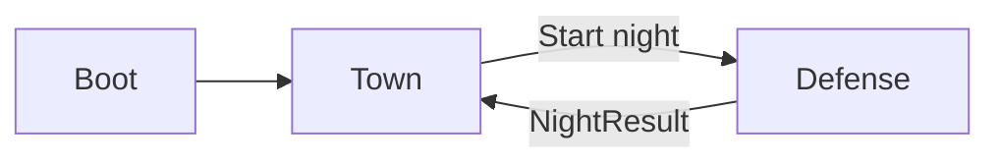

# Agent guide — DefenseGame

This repo is a **code-only**, **top-down real-time** action RPG: **town meta by day**, **defend the settlement by night**. There is **no game editor** (no Godot/Unity scenes). All work happens in TypeScript + JSON in Cursor.

**Stack:** Phaser 3 · Vite · TypeScript · Capacitor (mobile wrapper, added when night loop is stable).

---

## Product loop



| Mode | Scene | Responsibility |
|------|--------|----------------|
| Boot | `BootScene` | Load `public/data/*.json`, assets, restore save |
| Meta | `TownScene` | Upgrades, resources, start night |
| Combat | `DefenseScene` | Real-time movement, attacks, waves, wall HP |

**Invariant:** `DefenseScene` never mutates town rules directly. It returns a `NightResult`; `GameState.applyNightResult()` applies changes once in `TownScene` or Boot handoff.

---

## Repository layout

```text
src/
  main.ts              # Phaser.Game config (portrait, FIT scale)
  config.ts            # Dimensions + tuning constants
  core/                # GameState, DataStore, EventBus
  input/               # VirtualStick, ActionButtons
  combat/              # Hitbox, DamageSystem, CombatEntity
  entities/            # Player, Enemy, Projectile
  ai/                  # EnemyBrain + behavior modules
  scenes/              # Boot, Town, Defense
  systems/             # WaveSpawner, TownBuildings
  ui/                  # HUD + building panels
public/data/           # JSON content (fetched at runtime)
assets/ or public/     # Sprites/audio (placeholders OK early)
docs/                  # This file, CI_RELEASES.md
```

**When adding features:** prefer new JSON rows + small behavior modules over growing scene files.

---

## Core types (source of truth: `src/config.ts`)

```ts
export type SaveGame = {
  night: number;
  gold: number;
  buildings: Record<string, number>;
  townWallHp: number;
  townWallHpMax: number;
  player: {
    hp: number;
    hpMax: number;
    weaponId: string;
    moveSpeed: number;
  };
  flags: string[];
};

export type NightResult = {
  won: boolean;
  goldEarned: number;
  wallDamage: number;
  night: number;
};
```

---

## Data examples (`public/data/`)

**enemies.json** — stats + `behavior` id (maps to `src/ai/behaviors/`):

```json
{
  "grunt": {
    "hp": 30,
    "speed": 70,
    "damage": 8,
    "behavior": "meleeChaser",
    "textureKey": "enemy_grunt"
  }
}
```

**waves.json** — keyed by night number:

```json
{
  "1": {
    "rewardGold": 40,
    "groups": [
      { "atMs": 0, "enemyId": "grunt", "count": 5, "intervalMs": 800 }
    ]
  }
}
```

**buildings.json**:

```json
{
  "wall": {
    "maxLevel": 5,
    "costByLevel": [50, 80, 120, 180, 250],
    "effect": "wallHpMax"
  },
  "blacksmith": {
    "maxLevel": 3,
    "costByLevel": [100, 200, 350],
    "effect": "playerDamage"
  }
}
```

---

## Implementation order (do not reorder without reason)

| Step | Done when |
|------|-----------|
| 1 | `DefenseScene`: virtual stick moves player on blank map |
| 2 | Melee hitbox + one pooled enemy dies |
| 3 | `WaveSpawner` night 1 + win/lose → `NightResult` |
| 4 | `TownScene` upgrade changes next night (wall or damage) |
| 5 | `GameState` persist (`localStorage`) |
| 6 | Capacitor + device smoke test |

Until step 2 feels good on a phone-sized viewport, avoid town art and skill trees.

---

## Combat conventions

- **Movement:** Arcade physics body on player/enemies; attack uses **custom hitboxes**, not physics overlap alone.
- **Player attack:** state machine `idle → windup → active → recovery`; damage only in `active` frames.
- **Pooling:** enemies and projectiles use pools before scaling waves.
- **Defense objective:** `townWallHp` — enemies may target wall when player is far (see `ai/behaviors/`).

---

## Commands

```bash
npm install
npm run dev          # Vite dev server (browser play-test)
npm run build        # production bundle → dist/
npm run typecheck
npm run test         # Vitest unit tests
npm run preview      # serve dist locally
```

---

## Agent workflow tips

1. **Scope files:** e.g. “only edit `DefenseScene.ts` and `WaveSpawner.ts`”.
2. **Content vs code:** new enemy = row in `enemies.json` + behavior if needed, not a new scene.
3. **Save safety:** extend `SaveGame` only with backward-compatible defaults in `GameState.createNew()`.
4. **Mobile:** `configureSceneInput` + **`createTouchButton`** (`pointerdown`, padded hit zones). **Floating stick** only after a small drag; any interactive UI under the finger blocks it.
5. **CI must stay green:** `typecheck`, `test`, `build` on every PR; merges to `main` publish the playable Pages URL (see `docs/CI_RELEASES.md`).

---

## Related docs

- [CI and releases](./CI_RELEASES.md)