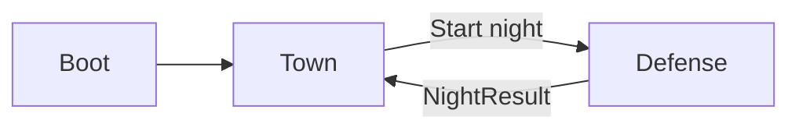

# Agent guide — DefenseGame

This repo is a **code-only**, **top-down real-time** action RPG: **town meta by day**, **defend the settlement by night**. There is **no game editor** (no Godot/Unity scenes). All work happens in TypeScript + JSON in Cursor.

**Stack:** Phaser 3 · Vite · TypeScript · Capacitor (mobile wrapper, added when night loop is stable).

---

## Product loop



| Mode | Scene | Responsibility |
|------|--------|----------------|
| Boot | `BootScene` | Load `public/data/*.json`, assets, restore save |
| Meta | `TownScene` | Upgrades, resources, start night |
| Combat | `DefenseScene` | Real-time movement, attacks, waves, wall HP |

**Invariant:** `DefenseScene` never mutates town rules directly. It returns a `NightResult`; `GameState.applyNightResult()` applies changes once in `TownScene` or Boot handoff.

---

## Repository layout

```text
src/
  main.ts              # Phaser.Game config (portrait 540×1200, FIT + autoRound)
  config/              # Tunable constants only (+ types that describe those tunables)
  content/             # Code-defined content manifests (assets, spell catalog)
  core/                # GameState, saveTypes, DataStore, EventBus
  input/               # VirtualStick, ActionButtons
  combat/              # Hitbox, DamageSystem, Knockback, SpellCastController, SpellEffects
  debug/               # DebugState registry flags, HitboxDebugDraw
  entities/            # Player, Enemy, EnemyCombat, Projectile
  ai/                  # EnemyBrain (wall rush + player aggro)
  pathfinding/         # Nav grid, A*, line-of-sight
  scenes/              # Boot, Town, Defense, DebugMenu
  systems/             # WaveSpawner, TownBuildings
  ui/                  # SpellBar, CastBar, touch buttons, HUD
public/data/           # JSON content (fetched at runtime)
assets/ or public/     # Sprites/audio (placeholders OK early)
docs/                  # AGENTS, TESTING, CI_RELEASES, REFACTOR_PLAN; ROADMAP at repo root
```

**When adding features:** prefer new JSON rows + small behavior modules over growing scene files.

---

## Where constants live

| Layer | Path | Holds |
|-------|------|--------|
| **Tuning** | `src/config/` | `GAME`, `PLAYER_TUNING`, `PLAYER_AGGRO_RADIUS`, `DEFENSE_MAP` / `DEFENSE_OBSTACLES`, spell bar **layout** (`SPELL_BAR`, `CAST_BAR` px). No save schemas, no asset manifests, no spell damage tables. |
| **Code content** | `src/content/` | `assets.ts` (texture keys, file paths, nine-slice), `spells.ts` (`SPELL_CATALOG`, spell ids). Candidate to move spells → `public/data/spells.json` later. |
| **Runtime JSON** | `public/data/` | `enemies.json`, `waves.json`, `buildings.json` (fetched in Boot). |

Save persistence shapes: `src/core/saveTypes.ts` (`SaveGame`, `NightResult`, `SAVE_VERSION`). `src/config.ts` re-exports **tuning only** from `src/config/index.ts`.

---

## Data examples (`public/data/`)

**enemies.json** — per-enemy stats + `behavior` id (maps to `src/ai/behaviors/`). Combat timings/ranges live under optional `combat`; omitted keys inherit typed defaults in `src/core/enemyTuning.ts` (grunt-compatible melee/wall baseline). Player aggro radius stays global: `PLAYER_AGGRO_RADIUS` in `src/config/enemy.ts`.

| `combat` block | Used when `behavior` is |
|----------------|-------------------------|
| `wall` | All (north wall objective) |
| `melee` | `meleeChaser` (arc swipe vs player) |
| `arrowRain` | `arrowRainArcher` (telegraphed floor AoE) |
| `javelineer` | `javelineer` (kite band + toss) |
| `stationaryRanged` | `stationaryRanged` (hold + straight bolt) |

```json
{
  "grunt": {
    "hp": 30,
    "speed": 85,
    "damage": 8,
    "behavior": "meleeChaser",
    "textureKey": "enemy_grunt"
  },
  "arrow_rain_archer": {
    "hp": 28,
    "speed": 52,
    "damage": 9,
    "behavior": "arrowRainArcher",
    "textureKey": "enemy_arrow_rain_archer",
    "combat": {
      "wall": { "damage": 6, "triggerRange": 42, "hitRange": 34 },
      "melee": {
        "triggerRange": 36,
        "range": 26,
        "arcDeg": 70,
        "windupMs": 380,
        "activeMs": 110,
        "recoveryMs": 480,
        "cooldownMs": 350
      },
      "arrowRain": {
        "preferredRange": 150,
        "attackTriggerRange": 168,
        "windupMs": 900,
        "activeMs": 1200,
        "recoveryMs": 520,
        "cooldownMs": 2200,
        "zoneRadius": 72,
        "tickIntervalMs": 300,
        "tickDamageScale": 0.55,
        "maxTicks": 4
      }
    }
  }
}
```

New melee enemies can omit `combat` entirely. Override only what you need (e.g. `"combat": { "melee": { "windupMs": 500 } }`).

**waves.json** — keyed by night number:

```json
{
  "1": {
    "rewardGold": 40,
    "groups": [
      { "atMs": 0, "enemyId": "grunt", "count": 5, "intervalMs": 800 }
    ]
  }
}
```

**buildings.json**:

```json
{
  "wall": {
    "maxLevel": 5,
    "costByLevel": [50, 80, 120, 180, 250],
    "effect": "wallHpMax"
  },
  "blacksmith": {
    "maxLevel": 3,
    "costByLevel": [100, 200, 350],
    "effect": "playerDamage"
  }
}
```

---

## Implementation order (do not reorder without reason)

| Step | Done when |
|------|-----------|
| 1 | `DefenseScene`: virtual stick moves player on blank map |
| 2 | Melee hitbox + one pooled enemy dies |
| 3 | `WaveSpawner` night 1 + win/lose → `NightResult` |
| 4 | `TownScene` upgrade changes next night (wall or damage) |
| 5 | `GameState` persist (`localStorage`) |
| 6 | Capacitor + device smoke test |

Until step 2 feels good on a phone-sized viewport, avoid town art and skill trees.

---

## Combat conventions

- **Movement:** Arcade physics body on player/enemies; attack uses **custom hitboxes**, not physics overlap alone.
- **Player attack:** state machine `idle → windup → active → recovery`; damage only in `active` frames.
- **Pooling:** enemies and projectiles use pools before scaling waves.
- **Defense objective:** `townWallHp` — north wall bar at top of the field (`northWallAttackY()` in `src/config/defense.ts`); grunts path with A* unless player has LOS within `PLAYER_AGGRO_RADIUS` (`src/config/enemy.ts`). After LOS breaks, `resolveEnemyTarget` in `EnemyBrain` chases `lastKnownPlayer*` for `PLAYER_CHASE_MEMORY_MS`, then eases velocity toward the wall over `WALL_VELOCITY_BLEND_MS` (`applyChaseVelocity` in `behaviors/movement.ts`).

---

## Commands

```bash
npm install
npm run dev          # Vite dev server (browser play-test)
npm run build        # production bundle → dist/
npm run typecheck
npm run test         # Vitest unit tests
npm run e2e:manual   # maintainer-only: build:e2e + Playwright (not CI / not default verify)
npm run preview      # serve dist locally
```

---

## Agent workflow tips

1. **Scope files:** e.g. “only edit `DefenseScene.ts` and `WaveSpawner.ts`”.
2. **Content vs code:** new enemy = row in `enemies.json` + behavior if needed, not a new scene.
3. **Save safety:** extend `SaveGame` only with backward-compatible defaults in `GameState.createNew()`.
4. **Mobile:** touch buttons scale on press; **Town → Reset save** (tap twice) calls `resetSaveAndReload()` — clears `localStorage` and reloads with `?fresh=` (no hard refresh needed).
5. **Config vs content:** edit numbers in `src/config/`; edit spell definitions in `src/content/spells.ts`; edit waves/enemies in `public/data/`. Spell bar layout: `config/spellBar.ts`; defaults: `content/spells.ts` + `save.spellBar` on `SaveGame` (`core/saveTypes.ts`).
6. **Debug:** **Town** or **Defense → Debug** opens `DebugMenuScene`. Toggles live in registry `debugFlags`: **Hitboxes: ON** (`showHitboxes`) — `DefenseScene` redraws combat arcs via `HitboxDebugDraw`. **Touch input: ON** (`showTouchInput`) — on-canvas overlay via `TouchInputDebugDraw`: finger crosshairs (Phaser pointer coords / FIT scale), virtual-stick base/knob/dead zone, HUD exclusion rects, and tap-to-focus pick radius flash in Defense. **Enemy paths: ON** (`showEnemyPaths`) — planned A* polylines and chase/wall targets via `PathDebugDraw`. **World scale: 1× / 2× / 3×** cycles session-only `registry.worldPixelScale` (world sprites/ground/colliders; HUD fixed).
7. **Waves:** nights `1`–`10` in `public/data/waves.json`; table in [WAVES.md](./WAVES.md).
8. **Combat:** each enemy has its own `EnemyCombat` FSM (windup/active/recovery + per-enemy cooldown). Player melee/ranged applies `Knockback` (`PLAYER_TUNING.meleeKnockback` > `rangedKnockback`). No shared enemy touch-damage loop.
9. **Spells:** Defense HUD spell grid (`SpellBar`, 4×2 — eight slots); **Nova** instant AoE, **Fireball** / **Heal** channeled. Long-press slot toggles per-spell auto-cast (gold border). Auto-cast priority follows grid order; channeled spells skip while moving. Combat mode cycles **Melee / Ranged / Auto combat** (`A.COM`). Channeling zeroes movement; stick input interrupts. `CastBar` under the player shows cast progress: amber windup, sky-blue effect channel (HUD: Casting… vs Channeling…).
10. **CI must stay green:** `typecheck`, `test`, `build` on every PR; merges to `main` publish the playable Pages URL (see `docs/CI_RELEASES.md`).

### Display / mobile sharpness (`main.ts`, `src/ui/screenLayout.ts`)

- **Design canvas:** `GAME.width` × `GAME.height` is **540×1200** (9:20). On **1080×2400** panels, Phaser `Scale.FIT` lands on an **integer 2×** upscale (less fractional blur than the old 390×844 base).
- **`scale.autoRound`** and **`render.roundPixels`** snap canvas CSS size and texture draws. UI Text uses `registry.renderResolution` (capped DPR via `clampRenderResolution`) for extra sharpness on 3× browsers.
- **`bindViewportToScale(game)`** (in `main.ts`) sizes the parent from `visualViewport` and calls `updateBounds()` so pointers and `cameraWorldPoint()` stay aligned under FIT + mobile browser chrome.
- **Pixel art:** `configurePixelArtTextures` in Boot sets **nearest-neighbor** on sprite/ground keys; `SPRITE_DISPLAY` is **64px** on-screen (2×). UI buttons/text remain vector.
- **Fullscreen:** Town (top-left) and Debug menu toggle via `pointerup`. **iOS Safari** often lacks Fullscreen API — button shows **“Fullscreen: N/A (iOS)”** and no-ops.

---

## Related docs

- [Testing](./TESTING.md)
- [CI and releases](./CI_RELEASES.md)
- [Refactor plan](./REFACTOR_PLAN.md) — splitting `DefenseScene` and other large files
- [Roadmap](../ROADMAP.md) — milestones and known gaps