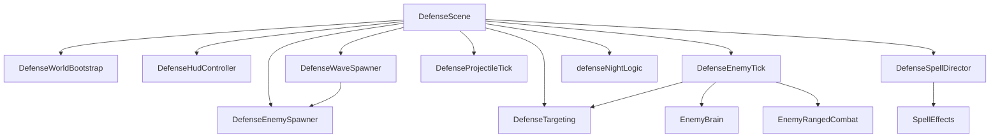

# Refactor plan — splitting large source files

**Status (2026-11-17):** PR1–PR9 and PR11 are merged or committed on `main`; PR10 (`DefenseSpellDirector`), PR12 (pooling), and P1/P2 splits remain. See [ROADMAP.md](../ROADMAP.md) checklist for PR URLs.

Goal: shrink scene-sized files into testable modules without changing behavior. Each step should be a small PR that keeps `npm run typecheck`, `npm run test`, `npm run build`, and CI e2e green.

**Measurement date:** line counts from `wc -l` on `src/**/*.ts` (rounded).

| File | Lines | Priority |
|------|------:|----------|
| `src/scenes/DefenseScene.ts` | **~1675** (post PR1–9) | P0 — primary target |
| `src/ui/touchButton.ts` | **663** | P1 |
| `src/entities/EnemyRangedCombat.ts` | **562** | P2 |

**Watch list (400–499 lines):** `SpellBarSortPanel.ts` (460), `enemyTuning.ts` (469), `screenLayout.ts` (418), `Projectile.ts` (417), `installE2E.ts` (417), `TownScene.ts` (381), `SpellEffects.ts` (325). No dedicated split until one grows past ~500 or gains a second owner team.

---

## `DefenseScene.ts` (~2176 lines)

### What it does today

`DefenseScene` is the entire night combat loop in one class:

| Concern | Rough location | Notes |
|---------|----------------|-------|
| Scene lifecycle / save handoff | `resetDefenseRunState`, `create` (L266–541), `shutdown` | Spell bar defaults, wall HP, registry save copy |
| World bootstrap | `create` L281–328 | Nav grid, ground/decor layers, wall barricade, obstacles, player spawn, physics groups, follow camera |
| Combat HUD wiring | `create` L330–497 | `CombatHudChrome`, ATK / MEL / AUTO toggles, `SpellBar`, `CastBar`, minimap, virtual stick, debug button, HUD text |
| Main `update` loop | L543–1018 | Channeling, player stick/attack, projectiles, enemy AI+combat dispatch, ground zones, ice walls, debug overlays, HUD strings, `evaluateNightEnd` |
| Spell input & effects | L1020–1356 | Auto-cast, ground aim, channel zones, `resolveSpellEffect`, blink/ice wall/frost nova helpers |
| Player combat & focus | L1395–1675 | Manual/auto attack, facing, tap-to-focus, ranged projectile spawn |
| Debug drawing | L1686–1773 | Hitboxes, paths, touch overlay |
| Wave scheduling & spawn | L1788–1860 | Inline `scheduleWave` (not yet `WaveSpawner`) + `spawnEnemyAt` |
| Night end & town return | L1862–1503 area | `endNight`, `transitionToTown`, reward gold |
| E2E surface | L1925+ | `e2e*` methods consumed by `installE2E.ts` |

Most combat math already lives in `src/combat/`, `src/entities/`, and `src/ai/`; the scene still **orchestrates** timing, targets, and Phaser wiring.

### Target modules (proposed paths)

```text
src/scenes/
  DefenseScene.ts              # Thin coordinator: Phaser.Scene, owns subsystems, calls them from create/update
  defenseNightLogic.ts         # (exists) evaluateNightEnd
  defense/
    DefenseWorldBootstrap.ts   # Ground, decor, wall strip, obstacles, player, groups, camera (create slice)
    DefenseHudController.ts    # Chrome, buttons, spell bar, cast bar, minimap, stick mask, uiBlockers
    DefenseWaveSpawner.ts      # scheduleWave + spawnPlanComplete timing (AGENTS.md name: WaveSpawner → scene-local first)
    DefenseEnemySpawner.ts     # spawnEnemyAt, defaultEnemyDef, enemyGroup registration
    DefenseEnemyTick.ts        # Per-enemy update loop (brain + behavior switch + wall damage + player hit)
    DefenseProjectileTick.ts   # Player spell projectiles + enemy projectiles filters
    DefenseSpellDirector.ts    # onSpellCastRequest, channel state, resolveSpellEffect, ground zones, ice walls
    DefenseTargeting.ts        # Focus enemy, screen tap, facingTarget, nearestEnemyForMode
    DefenseNightEnd.ts         # endNight body: NightResult, persist, UI for return button (optional split from scene)
    DefenseSceneE2E.ts         # e2e* implementations (imported by DefenseScene)
```

**`src/systems/WaveSpawner.ts` (optional later):** If wave logic stays pure (wave JSON + `time.delayedCall` + spawn callback), move `DefenseWaveSpawner` to `systems/` once DefenseScene no longer passes half the scene as closure state. `docs/AGENTS.md` already names this module; night scheduling is still duplicated in-scene today.

### Dependency flow



- **DefenseScene** holds authoritative arrays: `enemies`, `projectiles`, `enemyProjectiles`, `save`, `wallHp`, `spellCaster`, `enemySpellStatus`.
- Subsystems receive a **narrow context interface** (e.g. `DefenseRuntimeContext`) with getters/mutators, not the whole scene class — avoids circular imports.
- **No new singletons;** pass `Phaser.Scene` + context into pure helpers where possible (pattern: `evaluateNightEnd`).

### Merge order (small PRs)

| PR | Extract | Risk | Why this order |
|----|---------|------|----------------|
| 1 | `DefenseSceneE2E.ts` — move `e2e*` methods only | Low | No gameplay change; e2e is the safety net for later PRs |
| 2 | `DefenseWaveSpawner.ts` — `scheduleWave` + `spawnPlanComplete` flags | Low | Pure timing; behavior unchanged if callbacks call existing `spawnEnemyAt` |
| 3 | `DefenseEnemySpawner.ts` — `spawnEnemyAt`, `defaultEnemyDef` | Low | Used by waves and e2e `e2eSpawnEnemy` |
| 4 | `defenseNightLogic` already extracted; **move `endNight` helpers** to `DefenseNightEnd.ts` (keep `evaluateNightEnd` import) | Low | Small, covered by `defenseNightLogic.test.ts` + e2e `forceWinNight` |
| 5 | `DefenseTargeting.ts` — focus, tap, `facingTarget`, UI hit tests | Medium | Touch/focus regressions — lean on `e2e/touch-input.spec.ts` |
| 6 | `DefenseHudController.ts` — everything from `createTouchCircleButton` through stick setup | Medium | Visual/e2e: `e2e/visual.spec.ts`, spellbar specs |
| 7 | `DefenseWorldBootstrap.ts` — map, obstacles, player, groups | Medium | Collision/nav: unit tests on nav grid unchanged; e2e `smoke-enter-defense` |
| 8 | `DefenseProjectileTick.ts` — two `filter` loops in `update` | Medium | `e2e` combat + projectile count flags |
| 9 | `DefenseEnemyTick.ts` — enemy for-loop (L698–938) | **High** | Largest behavioral surface; do after spawner/projectiles stable |
| 10 | `DefenseSpellDirector.ts` — spell private methods block | **High** | Many spells; extend `SpellCastController` tests first |
| 11 | Optional: promote `DefenseWaveSpawner` → `src/systems/WaveSpawner.ts` | Low | Docs/agents alignment only once API is stable |
| 12 | **Pooling PR (separate track):** enemy/projectile pools inside `DefenseEnemySpawner` + `Projectile.ts` | Medium | AGENTS.md convention; not required for file split |

**Estimated total:** **10–12 PRs** for `DefenseScene` decomposition, plus **1 optional** systems move and **1 pooling** PR when ready.

### How tests protect each step

**Existing coverage**

| Layer | Guards |
|-------|--------|
| Vitest | `defenseNightLogic.test.ts`, `GameState.test.ts`, combat/spell/pathfinding/ui unit tests, `townBuildingMenu.test.ts`, `DataStore.integration.test.ts` |
| Playwright | `e2e/smoke.spec.ts` (boot, assets, enter defense), `touch-input.spec.ts`, `visual.spec.ts` (540×1200 snapshots), spellbar visual/texture/layout specs, town spell panel drag |
| E2E API | `DefenseScene.e2e*` + `installE2E.ts` — stick, melee/ranged, cast spell slot, spawn/kill enemies, `forceWinNight` |

**Add or extend first (before PRs 8–10)**

1. **Vitest — `DefenseWaveSpawner`:** Given a `WaveDef` with mocked `delayedCall`, assert spawn count and `spawnPlanComplete` flip time (no Phaser scene required if scheduler is injected).
2. **Vitest — `DefenseEnemyTick`:** One table-driven test per behavior branch (`arrowRainArcher`, `javelineer`, …) with fake `EnemyInstance` + stub `attackTarget` — extract loop incrementally and lock damage to wall/player.
3. **Vitest — `DefenseTargeting`:** `findEnemyNearWorldPoint`, `isPointerOverUi` with fake pointer coords (geometry only).
4. **Playwright — short spell regression:** Cast cone spell slot in e2e (if not already covered in spellbar specs) after `DefenseSpellDirector` move.
5. **Do not** duplicate full night playthrough in unit tests; keep **`evaluateNightEnd` pure** and use e2e for integration.

After each PR: `npm run typecheck && npm run test && npm run build` and rely on CI **e2e** job.

---

## `touchButton.ts` (~663 lines)

### What it does

Single module for:

- Press/tint/scale visuals (`bindContainerPress`, textured vs vector backgrounds)
- `createTouchButton`, `createTouchToggleButton`, `createTouchCircleButton`
- Hit-area helpers: `interactiveObjectScreenRect`, `containerScreenRect`, `isTouchButtonVisuallyPressed`, `pointerInScreenRect`
- Long-press wiring (`bindTapOrLongPress`) — gesture slop already in `touchButtonGesture.ts`

Used across **Town**, **Defense**, and **DebugMenu**.

### Proposed split

| New file | Contents |
|----------|----------|
| `src/ui/touchButtonPress.ts` | `bindContainerPress`, `bindTapOrLongPress`, press scale/tint helpers |
| `src/ui/touchButtonFactories.ts` | `createTouchButton`, `createTouchToggleButton`, `createTouchCircleButton` |
| `src/ui/touchButton.ts` | Re-export public API + shared types (keep imports stable for scenes) |

### PR order

1. Extract `touchButtonPress.ts` (no call-site changes if re-exported).
2. Extract factories.
3. Optional: collapse duplicate visual helpers.

### Tests

- **Existing:** `touchButton.test.ts`, `touchButtonGesture.test.ts`, town/defense e2e press detection via `getUiTapTargets()`.
- **Add:** None required if re-exports preserve behavior; run full Vitest + `e2e/town-touch.spec.ts` after PR 1.

---

## `EnemyRangedCombat.ts` (~562 lines)

### What it does

State types and **per-behavior update functions** for ranged enemies:

- `updateArrowRainCombat`, `updateJavelineerCombat`, `updateStationaryRangedCombat`, `updateRangedHybridCombat`, `updateLobberCombat`
- Shared `advanceCombatPhase` helper

`DefenseScene` (or future `DefenseEnemyTick`) dispatches on `e.behavior` and pushes projectiles into scene arrays.

### Proposed split

| New file | Contents |
|----------|----------|
| `src/entities/enemyRanged/arrowRainCombat.ts` | Arrow rain + telegraph |
| `src/entities/enemyRanged/javelineerCombat.ts` | Javelineer |
| `src/entities/enemyRanged/stationaryRangedCombat.ts` | Sentry-style bolt |
| `src/entities/enemyRanged/rangedHybridCombat.ts` | Hybrid melee/ranged |
| `src/entities/enemyRanged/lobberCombat.ts` | Lob + blast |
| `src/entities/enemyRanged/combatPhase.ts` | `advanceCombatPhase` |
| `src/entities/EnemyRangedCombat.ts` | Re-export types + functions |

### PR order

1. Extract `combatPhase.ts` + one behavior (e.g. `stationaryRanged` — smallest).
2. One PR per remaining behavior (5 PRs) or batch pairs if diffs stay &lt;200 lines.

### Tests

- **Existing:** `EnemyRangedCombat.test.ts` — extend with one case per extracted file when splitting.
- **Integration:** Defense e2e does not cover every enemy; add Vitest cases when moving each behavior file.

---

## Principles (all refactors)

1. **Behavior-neutral diffs** — move code, don’t “fix while splitting.”
2. **Stable imports** — barreled re-exports from old paths when many call sites exist (`touchButton`, `EnemyRangedCombat`).
3. **Interface context** for Defense extractions — one `DefenseRuntimeContext` type in `src/scenes/defense/types.ts` grows slowly.
4. **Content stays JSON** — waves/enemies/spells do not move into scene files during refactor.
5. **CI is the merge gate** — see `docs/TESTING.md` and `docs/CI_RELEASES.md`.

---

## Status (completed)

**DefenseScene decomposition (PR1–PR11):** Landed on `main` or queued on `cursor/*-4e8e` branches. `DefenseScene.ts` reduced from **~2176** to **~1152** lines (`wc -l`). New modules under `src/scenes/defense/` plus `src/systems/WaveSpawner.ts`.

| Step | Module | Lines (approx.) |
|------|--------|----------------:|
| PR7 | `DefenseWorldBootstrap.ts` | 76 |
| PR8 | `DefenseProjectileTick.ts` | 129 |
| PR9 | `DefenseEnemyTick.ts` | 287 |
| PR10 | `DefenseSpellDirector.ts` | 670 |
| PR11 | `systems/WaveSpawner.ts` | 39 |

**Skipped:** PR12 pooling (AGENTS.md convention; not required for file split).

**P1:** `touchButton.ts` split **not completed** (663 lines unchanged).

**P2:** Partial — `src/entities/enemyRanged/combatPhase.ts` extracted; per-behavior files remain future work.

---

## Related docs

- [AGENTS.md](./AGENTS.md) — architecture and implementation order
- [ROADMAP.md](../ROADMAP.md) — when to schedule refactor vs content work
- [TESTING.md](./TESTING.md) — Vitest + Playwright