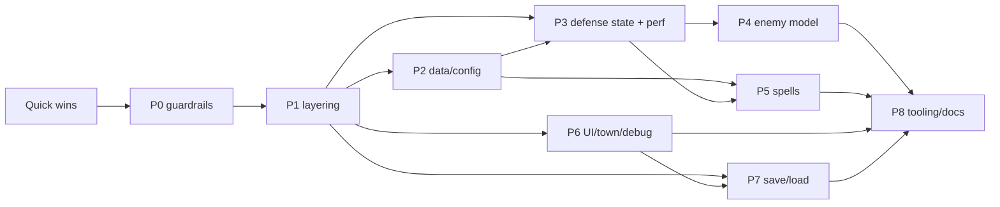

# Refactor plan v2: whole-codebase audit

**Status (2026-11-27):** In progress on branch `refactor/plan-execution`. Quick wins, Phase 0, Phase 1 and Phase 2 are done (see [Execution log](#execution-log) for what changed against this plan). Phases 3–8 are next. The audit below was written from `main` at `3b832d8`; its numbers are the "before" baseline.
**Scope:** an audit at every level (architecture, systems, files/classes, functions, data, tooling), then a phased plan.
**Predecessor:** [archive/REFACTOR_PLAN.md](./archive/REFACTOR_PLAN.md) (file splits for DefenseScene, touchButton and EnemyRangedCombat, all finished).

**Ground rules (same as v1):** every item ships as a small PR that keeps `npm run verify`, `npm run test:coverage`, `npm run build` and Chromium Playwright green. A PR must not change behaviour unless the item is marked **behaviour change**. Run `npm run sim:economy` before and after any item that touches data or the economy, and diff the results.

---

## 0. Baseline (measured 2026-11-26)

| Metric | Value | How |
|---|---:|---|
| Production TS files (`src/`, excluding tests and `src/test/`) | 326 | `git ls-files` |
| Production TS lines | ~48.5k | `wc -l` |
| Unit test files / tests | 267 / 1717, all passing (~25 s) | `npm run verify` |
| Coverage (stmts / branches / funcs / lines) | 94.8 / 91.8 / 95.7 / 95.2 % | `npm run test:coverage` |
| Playwright specs | 30 (`e2e/*.spec.ts`, ~3.5k lines) | |
| Runtime JSON files | 17 (`public/data/`) | |
| Files ≥ 400 lines | 19 (largest: `DefenseScene.ts` at 1141) | |
| Functions ≥ 60 lines, ≥ 25 branches or nesting ≥ 5 | 98 | TS-AST scan (see Appendix A) |
| Runtime import cycles (type-only imports skipped) | **17** | `madge --circular` with `skipTypeImports` |
| Import cycles counting type imports | 85 | `madge --circular` |
| Exact clones (≥ 12 lines / 80 tokens) | 19 clones, 327 lines (0.7 %) | `jscpd` |
| Hex colour literals outside `ui/theme/` | 247 | `rg 0x[0-9a-f]{6}` |
| Mutable `export let` config globals with Proxy "not loaded" sentinels | 16 bindings in 7 modules | `rg '^export let'` |
| `isE2EEnabled()` / `publishE2E` call sites outside `src/e2e/` | 11 files | `rg` |

Overall: the codebase is in good shape. Typing is strict (`noUncheckedIndexedAccess`, `exactOptionalPropertyTypes`), coverage is high, CI gates are tight (Biome, knip, coverage floors) and exact duplication is low. The debt that remains is structural, not cosmetic:

1. **Implicit shared state.** Mutable module globals, stringly-typed `registry` keys, and a 150-line getter/setter "scene host".
2. **Layering that has drifted.** There are cycles, low layers importing high layers, and E2E or debug concerns inside domain code.
3. **Per-frame allocation in the defense loop.** Enemy peer lists are O(n²), and `filter`, closures and context objects are rebuilt every frame.
4. **A behaviour model that is half data-driven.** AI movement uses a registry, but combat dispatch is an `if/else` chain over a free-form `behavior: string` and a flat `behaviorExtra` bag.
5. **Large imperative UI builders** that hard-code colours and sizes.

## Execution log

Status per item, plus every place where the work differed from the plan and why. Each item is its own commit on `refactor/plan-execution`; `npm run verify` and `npm run test:coverage` were green after every one.

| Item | Status | Notes |
|---|---|---|
| QW1–QW3, QW5–QW10 | Done | QW3 proven behaviour-identical by the P0.4 golden snapshot (run against the pre-QW3 code). |
| QW4 | **Skipped** | Phaser's `Text.setText` already returns early when the string is unchanged, so a cache adds nothing. `dataStore` is cached by QW9. |
| P0.1 + P0.2 | Done, **changed** | One script, `scripts/check-architecture.mjs` (`npm run check:arch`, in `verify` and CI), does both: TS-AST runtime import graph, cycle detection (SCCs) and folder layer rules. It enforced its baseline from day one instead of being report-only, because a baseline that can only shrink is just as safe and catches regressions sooner. Measured as SCCs there were 6 runtime cycles, not 17 (madge lists every path through one SCC); the `lazyScenes` "cycles" were dynamic `import()`s and are not counted. |
| P0.3 | Done, **changed** | Vitest 5 has no working `bench()`, so `npm run perf` runs an opt-in `DefenseEnemyTick.perf.test.ts` (`PERF=1`). Numbers are in `docs/TESTING.md`. Finding: past ~60 enemies the frame cost is A* replans, not peer lists, so P3.3 should look at replan budgeting too. |
| P0.4 | Done | `src/test/defenseTickHarness.ts` + `defenseGolden.test.ts`: seeded headless `tickDefenseEnemies` with every shipped behaviour, digests after N frames. Keyed by a hash of the tuning JSON so balance edits skip it (refresh with `UPDATE_GOLDEN=1`). It found a real crash: `meleeChaser` threw when a replan returned an empty path while `pathActive` was set (fixed in its own commit). |
| P0.5 | Done | Biome `noExcessiveCognitiveComplexity`: cap 25 for all code; the 19 files that exceed it today are listed in a `biome.json` override capped at 84 (current worst, `tickDefenseEnemies`). Remove files from that list as phases split them. |
| P1.1 | Done | `ai/brainShared.ts` holds the helpers; `EnemyBrain.ts` only has `updateEnemyBrain`. |
| P1.2 | Done, **changed** | Pure world-scale lookups moved to `config/worldScale.ts` (not `world/`), because `config/defense` needs them and config may not import core. `DEFENSE_MAP.pathClearancePx` getter removed; callers use `maxNavObstacleClearancePx()`. |
| P1.3 | Done | `gear/consumableTypes.ts`, `STROKE_PX` in `uiRoundedRect`, direct imports instead of barrels. |
| P1.4 | Done, **changed** | `lazyScenes` already was a key → `import()` loader. It moved with `GameAssetLoader` to `scenes/loading/` (both start scenes and queue UI icons), which also removed `core → ui/icons`. |
| P1.5 | Done, **changed** | `core/storageKeys.ts` (not `core/save/`, which does not exist until P6.8). `gameMain` injects the E2E check with `setE2EStorageIsolation(isE2EEnabled)`. |
| P1.6 | Done | `core/economyPolicy.ts`; UI builds it with `debugEconomyPolicy(registry)`. Also covered `talents/talentLogic`. |
| P1.7, P1.8 | Done | `scenes/town/TownBuildings.ts`; `core/gameEvents.ts` typed bus, E2E subscribes in `attachE2EGame`. |
| P1.9 | **Partly done** | `installE2E` / `installE2EApi` / `installE2EDom` are now a lazy chunk loaded only in E2E mode (production `gameMain` no longer contains them). The `DefenseSceneE2E*` host stays static for now: it lives in the already-lazy Defense chunk, and making it async needs the `DefenseRunState` work, so it and the `as unknown as DefenseSceneE2eDelegate` cast move to **P3.2**. |
| P1.10 | Done | Baseline is empty: 0 cycles, 0 layer violations. `--update-baseline` can now only remove entries. The last violations were fixed by moving `config/defenseMaps` → `core/applyDefenseMaps`, `config/shadowformRuntime` → `combat/`, UI scale helpers → `config/uiScale.ts`, wave-planner and endless limits → `core/`, `nightEndMessaging` → `systems/`. |
| P2.1 + P2.2 | Done, **changed** | One store, `src/tuning/gameTuning.ts` (`setTuning(key, value)` freezes a copy; `tuning(key)` reads it and names the JSON file when Boot has not loaded it). It is a new top-level folder, not `core/data/tuning/`, because `config/defense` reads it and config may not import core; a new arch rule keeps `tuning/` importing only `config/`. The existing `apply*()` setters were kept as the write API, so DataStore, the test setup and the sim did not change. Player tuning stays two-level: `basePlayerTuning()` (frozen JSON) and `playerTuning()` (with gear and talents for the run). The three defense map arrays became read-only accessors. No `export let` remains in `src/`. Threading tuning through `DefenseServices` instead of a module accessor is left to P3.2. |
| P2.3 | **Partly done** | Ward post-hold constants are in `enemies.json` (`combat.ward.post*`), and the golden snapshot proved identical behaviour. **Moved on:** the spell `baseDamage ?? n` / `healAmount ?? 20` defaults and the `0.65` splash scale need a per-mechanic "required fields" table, so they go with the spell handler table in **P5.1**. The `rewardGold = 40` default is unreachable with valid data (it only applies when `waves.json` has no night 1); it goes with run-mode state in **P3.5**. The `DefenseNightEnd` colours and depth go with theme tokens in **P6.1**. |
| P2.4 | Tried, **not adopted** | `isolate: false` saves about 2.5 s of 8 s but gave 0–8 order-dependent failures over 4 runs (shared module state: `lazyScenes` promise cache, `vi.mock` leakage into `GameState` / autocast suites, game-event listeners). The listener leak is fixed; the rest moves to new item **P8.5**. |
| P2.5 | **Deferred** | Optional. Best done together with P5.1's per-mechanic spell field table. |

---

## 1. Architecture and project layout

### 1.1 Current layering (runtime imports between top-level `src/` folders)

These are the import counts that matter, from a TS-AST scan that skips `import type`:

| From → To | Count | Problem |
|---|---:|---|
| `config → entities / gear / core` | 1 / 1 / 3 | `config/` is documented as constants only, yet `config/defense.ts` imports `entities/entityPhysics` (cycle 3), `config/shadowformRuntime.ts` imports `gear/gearRuntime`, and `config/spellBar.ts` imports `core/displayScale`. |
| `core → ui / world / systems / e2e` | 1 / 1 / 3 / 2 | `core/GameAssetLoader` → `ui/icons/uiIcons`; `core/worldPixelScale` → `world/defenseObstacleBlocker` (cycle 2); `core/normalizePlayer` → `systems/endlessSpawnScheduler`; `core/GameState` and `core/saveSlots` → `e2e/e2eMode` for storage keys. |
| `gear → debug`, `systems → debug` | 1, 1 | `gear/shops.ts` and `systems/townBuildingMenu.ts` import `hasEnoughGold` from `debug/debugEconomy`, so a debug cheat sits inside an economy rule. |
| `systems → ui` | 2 | `systems/TownBuildings.ts` builds Phaser UI (`bindContainerPress`, `uiTextStyle`). It is a view, not a system. |
| `combat → e2e` | 2 | `combat/MeleeSwipeFx.ts` calls `publishE2E` / `isE2EEnabled`. |
| `entities → test` | 1 | `entities/testEnemyInstance.ts` is a test fixture inside production code and imports `src/test/shippedEnemyCombat`. |
| `entities → ui` | 1 | Enemy nameplates live in `ui/`, but the entity owns them. |
| `gear / talents / content / sim → public/data/*.json` | 4 / 1 / 1 / 10 | JSON is statically bundled *and* fetched at runtime by `DataStore.loadAll`. **This is intentional** so values can be edited easily; it is not a refactor target (§5.2). |

Target layering. Each layer may import only the layers below it; `debug`, `e2e` and `sim` are leaf consumers that nothing else imports.

```text
L0  config/ (layout/render constants)   content/ (asset keys, ids)   pathfinding/   util
L1  core/data (DataStore, normalize*, configValidation)   core/save (saveTypes, GameState, saveSlots)
L2  domain rules: gear/  talents/  economy (shops, buildings)  ai/  combat/rules  systems/ (pure)
L3  Phaser runtime: entities/  combat/fx  world/  input/  audio/  ui/
L4  scenes/ (+ scenes/defense, scenes/town)       bootstrap/gameMain
──  leaf consumers: debug/  e2e/  sim/   (inject via hooks, never imported by L0–L4)
```

### 1.2 Runtime import cycles (17)

From `madge --circular` with type-only imports skipped:

| # | Cycle | Fix |
|---|---|---|
| 1, 4–9 | `ai/EnemyBrain → ai/behaviors/index → behaviors/* → (back to EnemyBrain helpers)` | Move the shared brain helpers that behaviours import out of `EnemyBrain.ts` into `ai/brainShared.ts`. `EnemyBrain` then depends on `behaviors/index` one way only. |
| 2 | `config/defense → core/worldPixelScale → world/defenseObstacleBlocker → config/defense` | Move the obstacle-rect scaling out of `worldPixelScale` into `world/`. `core/worldPixelScale` should only know about the scale number. |
| 3 | `entities/entityPhysics ↔ config/defense` | `maxNavObstacleClearancePx` belongs with the nav and physics tuning, not `config/`. Invert by passing the clearance into `config/defense` helpers as a parameter. |
| 10 | `content/spellBarAutoCast ↔ content/spells` | Merge, or move the shared types into `content/spellTypes.ts`. |
| 11 | `gear/consumables ↔ core/normalizeConsumables` | Normalizer owns the types; `gear/consumables` imports them, not the reverse. |
| 12 | `ui/touchButtonPress ↔ ui/uiRoundedRect` | Extract a shared geometry type. |
| 13, 15–17 | `core/lazyScenes ↔ scenes/* ↔ townSetupSceneLifecycle / GameAssetLoader / debugMenuLifecycle` | `lazyScenes` should hold only `key → () => import()` thunks and be imported by `gameMain`. Scenes reach each other through scene keys (`this.scene.start(KEY)`), not module imports. |
| 14 | `ui/screenLayout → fpsHudLayout → defenseMinimap → screenLayout` | Move the shared layout primitives into `screenLayoutCore.ts`, which already exists. |

With type imports counted there are 85 cycles. Most run through `e2e/e2eGlobal → scenes/DefenseScene`, which is reached by **runtime** imports from `combat/MeleeSwipeFx`. Fixing §1.3 removes that hub.

### 1.3 E2E and debug code inside production paths

- `isE2EEnabled()` (`src/e2e/e2eMode.ts`) parses `new URL(window.location.href)` **on every call**. It is called every frame from `DefenseScene.update` and from `MeleeSwipeFx`. This is a hot-path allocation in production builds, where `VITE_E2E` is false and the query string is checked.
- `DefenseScene` statically imports `DefenseSceneE2EHost` → `DefenseSceneE2E*` (~1k lines), and `gameMain.ts` statically imports `e2e/installE2E` and `installE2EApi` (501 lines, one 445-line `buildApi` function). All of this ships in the production chunk.
- `DefenseScene.ts:1139` uses `this as unknown as DefenseSceneE2eDelegate`.
- Debug flags such as infinite gold live in the `registry` and are read inside economy rules (`gear/shops.ts`, `systems/townBuildingMenu.ts`).

**Direction:** compute E2E mode once at boot and expose it as a frozen `RuntimeFlags`. Load E2E modules with a dynamic `import()` behind `import.meta.env.VITE_E2E || flags.e2e`. Replace inline `publishE2E` calls in domain code with a small event emitter (`gameEvents.emit("meleeSwipe", …)`) that the E2E layer subscribes to. Pass debug economy overrides into rules as an explicit `EconomyPolicy` parameter.

### 1.4 Folder layout

- `src/combat/` (47 files) mixes pure rules (`DamageSystem`, `Hitbox`, `spellMechanics`, `spellKnockback`, `channeled*`, `spellInputQueue`) with Phaser FX (`*Fx.ts`, `*Pvfx.ts`, `*Telegraph.ts`; 24 of 47 files import Phaser at runtime). Split it into `combat/rules/` and `combat/fx/`.
- `src/ui/` has 54 files in its root next to 8 sub-folders. Group them as `ui/hud/` (CastBar, SpellBar, combatHudChrome, defenseHudLayout, defenseMinimap, enemyNameplate, TargetIndicator, GroundTargetReticle), `ui/panels/` (Inventory, Shop, Talent, SaveMenu, NightLootSummary, EndlessMode, WavePlanner, SpellBarSort), `ui/touch/` (touchButton*), and `ui/layout/` (screenLayout*, *HudLayout).
- `src/core/` (34 files) mixes data loading, validation, save, rendering hacks (`phaser3PixelParity`, `pixelArtTextures`, `pixelRenderDebug`) and run-mode state. Split it into `core/data/` (DataStore + `normalize*` + configValidation + dataFieldsDoc*), `core/save/` (GameState, saveSlots, saveTypes) and `render/` (pixel parity, pixel art textures, displayScale, worldPixelScale).
- `src/sim/` (2.6k lines) is a Node CLI tool inside `src/`. Keep it there so it can share gameplay code, but make it a declared leaf (§1.1) and keep it out of the coverage denominator if it is excluded from game tests.
- `src/entities/testEnemyInstance.ts` belongs in `src/test/`.
- Root-level `src/buildId.ts`, `src/ensureFreshBuild.ts` and `src/config.ts` next to `src/config/` should move to `src/app/` together with `bootstrap.ts`, `gameMain.ts`, `appUpdate/` and `pwa/`.

---

## 2. System-level audit

### 2.1 Defense loop (`scenes/DefenseScene.ts` and `scenes/defense/*`)

v1 split the 2.2k-line scene into 25 helper modules. The *state* stayed on the scene, though, so every helper reaches back into it:

- **`buildSceneHost()` (DefenseScene.ts:760–908)** is 149 lines of `get x() { return scene.x } / set x(v) { scene.x = v }` that feed `DefenseSpellDirectorHost & DefensePlayerCombatHost & DefenseGroundAimHost`. The spell-director host alone exposes about 57 members. That makes it a god object by proxy: any helper can mutate any field.
- There are 9 separate `*Host` types (`DefenseConsumablesHost`, `DefenseProjectileTickHost`, `DefenseSpellDirectorHost`, `DefenseSceneE2eHost`, `DefenseTargetingHost`, `DefenseEnemySpawnerHost`, `DefenseEnemyTickHost`, `DefenseGroundAimHost`, `DefensePlayerCombatHost`), and most of them overlap.
- `create()` (179 lines) copies about 25 fields out of `bootstrapDefenseWorld()` and `createDefenseHudController()` results into scene fields one at a time.
- `update()` (161 lines) builds two fresh host literals every frame for `tickDefenseProjectiles` / `tickDefenseEnemies`, each with 6–10 closures, plus `playerHurtbox` and the debug-draw argument objects. It then reassigns the returned arrays (`this.projectiles = projTick.projectiles`, …).
- **Invariant drift:** `docs/AGENTS.md` says *"DefenseScene never mutates town rules directly… `GameState.applyNightResult()` applies it once on the Town/Boot side."* In fact `DefenseNightEnd.ts` (`runDefenseCampaignNightEnd`, `runDefenseEndlessNightEnd`, `runDefenseSimulatedNightEnd`) resolves the economy (`resolveCampaignNightEnd`, `rollNightDrops`, `applyEndlessRunExit`), calls `persistSave` and writes `registry.set("save")` from the defense side. It also mixes those rules with HUD text and button creation, and holds two near-duplicate blocks (`jscpd`: lines 78↔131, 106↔160).

**Direction:**
- Introduce a plain `DefenseRunState` object for the mutable run data: wall HP, enemies, projectiles, zones, timers, flags.
- Introduce a `DefenseServices` object for the long-lived collaborators: player, navGrid, spellCaster, targeting, HUD handles, `worldScale`, `registerWorldDraw`.
- Helpers receive `(state, services)`. They mutate `state` directly instead of returning copies.
- Build the tick contexts once in `create()`.
- Move night-end rules into a pure `core/save/nightEnd.ts` that returns `{ save, result, drops }`. `DefenseNightEnd` keeps only presentation. Then either restore the documented invariant or update the doc to describe the real flow.

### 2.2 Enemies and AI (`entities/Enemy.ts`, `entities/EnemyCombat.ts`, `entities/enemyRanged/*`, `ai/*`)

- `EnemyInstance.behavior` is `string`, not a union. `getEnemyBehavior()` (`ai/behaviors/index.ts`) **silently falls back** to `meleeChaser` for unknown ids instead of failing at load.
- Movement dispatch is table-driven (`BEHAVIORS` record), but **combat dispatch is an `if/else` chain** in `tickDefenseEnemies` (`DefenseEnemyTick.ts:85–378`; 293 lines, 38 branches, nesting 9). The chain checks `e.behavior === "arrowRainArcher" && e.arrowRain`, `"javelineer"`, `"stationaryRanged"`, `"rangedHybrid"`, `"charger"`, `"lobber"` and `"bruiser"`, and each branch does its own projectile spawning and texture selection.
- `EnemyInstance` carries five optional per-behaviour state objects (`arrowRain?`, `javelineer?`, `stationaryRanged?`, `lobber?`, `rangedHybrid?`) **and** a flat `behaviorExtra` bag. That bag holds charge, strafe and ward fields for every enemy (`defaultBehaviorExtra`, Enemy.ts:102).
- Duplication: `charger.ts:144 ↔ wallSiege.ts:72` (31 lines), `wallSiege.ts:77 ↔ ward.ts:345` (20), `meleeChaser.ts:38 ↔ rangedKite.ts:31` (18), `javelineerCombat.ts:31 ↔ stationaryRangedCombat.ts:25` (25).
- Long behaviour functions: `wardBehavior` (165 lines), `chargerBehavior` (160), `meleeChaserBehavior` (159, nesting 6), `javelineerBehavior` (119, nesting 6), `applyRetreatPathing` (106), `updateEnemyCombat` (110, 33 branches), `updateArrowRainCombat` (111).
- Tuning hard-coded in code: `ai/behaviors/ward.ts:23–31` (`WARD_POST_HOLD_RADIUS_PX = 22`, `WARD_POST_BREAK_MOVE_PX = 44`, `WARD_POST_GRACE_MS = 1600`, …).

**Direction:**
- Define `type EnemyBehaviorId = keyof typeof ENEMY_BEHAVIORS` and validate it in `normalizeEnemy`.
- Make one `EnemyBehaviorModule` per behaviour, `{ move, combat?, createState, resolveCombatTuning }`, registered in one table.
- Replace the optional fields plus `behaviorExtra` with a discriminated `behaviorState`.
- `tickDefenseEnemies` then becomes roughly "for each enemy: brain → module.combat(e, ctx) → apply hits".

### 2.3 Spells (`scenes/defense/DefenseSpell*.ts`, `combat/Spell*.ts`, `combat/spell*.ts`, `content/spell*.ts`)

- `resolveDefenseSpellEffect` (`DefenseSpellResolve.ts:47`; 210 lines, 36 branches) is a `switch` over 15 mechanic kinds (`blast`, `projectile`, `projectile_aoe`, `tracking_projectile`, `swing`, `tracking_swing`, `cone`, `channeled_cone`, `channeled`, `channeled_area`, `instant_targeted`, `heal`, `blink`, `buff`, `ice_wall`).
- `combat/SpellEffects.ts` (498 lines) has **hard-coded fallback numbers** for data fields: `def.baseDamage ?? 20` (lines 68, 120), `?? 16` (210, 385), `?? 12` (248), `?? 10` (422), `healAmount ?? 20` (497), a chain-lightning falloff `* 0.65` (385), and `showPlayerMeleeSwipe(…, 160, 160)` (212). There are also internal clones (218 ↔ 255).
- `DefenseSpellDirector.ts` (522 lines) owns queueing, auto-cast, ground-aim arming, channel start and damage multipliers. `updateDefenseSpellChanneling` is 79 lines with nesting 4.
- Spell FX controllers are nullable scene fields toggled through the host (`blizzardChannelFx`, `healChannelFx`, `iceCastWindupFx`, `groundAoeTelegraph`, `lingerAoeTelegraph`).

**Direction:**
- Use a `SpellMechanicHandler` table (`Record<SpellMechanicKind, (ctx, def, aim) => void>`) with one file per mechanic family.
- Make `baseDamage`, `healAmount` and falloff required, or typed defaults, in `normalizeSpells` / `spells.json`, so there are no `??` numbers in effect code.
- Spell FX lifecycle moves into a `SpellFxRegistry` owned by the director.

### 2.4 Player, projectiles and combat core

- `entities/Projectile.ts` (484 lines): `updateProjectile` is 114 lines, 21 branches; `updateEnemyProjectile` is 81. Player and enemy projectiles live in one file with separate pools and update paths.
- `tickDefenseProjectiles` (149 lines) returns new arrays every frame, and the scene reassigns them.
- `combat/` pure modules are well tested. Keep them as they are and only move them (§1.4).

### 2.5 Waves, endless and wave planner (`systems/*`, `scenes/defense/DefenseWaveSpawner.ts`, `DefenseEndlessSpawn.ts`)

- `systems/WaveSpawner.ts` and `scenes/defense/DefenseWaveSpawner.ts` both exist. v1 planned to move scheduling into `systems/` "once DefenseScene no longer passes half the scene as closure state". §2.1 makes that possible.
- Endless and Wave Planner run as two parallel stacks: `EndlessModeSetupScene` ↔ `WavePlannerSetupScene` (18-line clone at 100↔73), `EndlessModePanel` ↔ `WavePlannerPanel` (19-line clone), and `EndlessModePanelBuild` (382-line builder) ↔ `WavePlannerPanelBuild` (303-line builder, 13-line clone). Both also share `rosterPanelShared.ts`.
- `DefenseScene` holds `endlessSelections`, `wavePlannerMode`, `endlessInfiniteHp` and `rewardGold = 40` (a magic default, line 171), and branches on mode in `refreshHudText`, `update` and night end.

**Direction:** define a `DefenseRunMode` strategy (`campaign | endless | wavePlanner`) with `{ hudHeader, spawnPlan, onRunEnd, rewardGold }`, resolved once by `resolveDefenseRunSetup`. Also extract a shared `RosterSetupScene` / `RosterPanel` base.

### 2.6 Town, economy, gear and talents

- `TownScene.ts` (555 lines): `create()` is 89 lines with nested callbacks. About 20 `e2e*` methods (lines 210–390, for example `e2eStartEndless` and `e2eGetUiTapTargets`) are part of the production scene class, even though `scenes/town/TownSceneE2E.ts` exists. `this.save = this.registry.get("save") as SaveGame` appears 5 times, at lines 123, 155, 159, 272 and 513.
- `systems/TownBuildings.ts` is UI (§1.1). Move it to `ui/town/` or `scenes/town/`.
- `gear/shops.ts` (438 lines) mixes stock generation, pricing, buy requests and save shape.
- UI state reducers already exist (`gearPanelLogic.reduceGearPanel`, `saveMenuLogic.reduceSaveMenu`), which is good. `reduceGearPanel`, however, is 198 lines with 47 branches; split it per action group.
- `gear/gearText.ts:24 ↔ talents/talentText.ts:17` is a 16-line clone of stat-line formatting.

### 2.7 Save/load (`core/GameState.ts`, `core/saveSlots.ts`, `core/saveTypes.ts`)

- There are two read paths: `loadSave()` (GameState.ts:57) and `saveSlots` (lines 83 and 114). They use different shape checks (`isSaveGameShape` versus `!parsed.save`).
- **On a version mismatch the save is deleted, not migrated** (saveSlots.ts:73 comment; `SAVE_VERSION = 2`). `migrateSave` only does same-version fix-ups. Any future `SaveGame` change that is not additive will wipe players' saves.
- The docs say `GameState.createNew()` / `GameState.applyNightResult()` (`docs/AGENTS.md` lines 11 and 82), but the code exports free functions `createNewSave`, `applyNightResult` and `applyNightResultDetailed`.
- Storage keys live in `e2e/e2eMode.ts`. They belong in `core/save/storageKeys.ts`, with the E2E prefix injected.

**Direction:** one `SaveRepository` with `read(slot) / write(slot) / list()` and one validator. Add a migration chain, `migrations: Record<fromVersion, (raw) => raw>`, with fixture tests for every historical version. **Behaviour change**: old saves would survive instead of being deleted. Ship it on its own.

### 2.8 Input and UI

- Modal lifecycle (`acquireModalInput` + `bindModalDimBackdrop` + teardown) is repeated in 8 panels: TalentPanel, SaveMenuPanel, EndlessModePanelBuild, WavePlannerPanelBuild, TownDefenseLoadingOverlay, EndlessModePanelLoadingSkeleton, SpellBarSortPanel and gearPanelChrome.
- Huge imperative builders:

  | Builder | Location | Lines |
  |---|---|---:|
  | `buildEndlessModePanelUi` | | 382 |
  | `buildDefenseHudController` | | 308 |
  | `buildWavePlannerPanelUi` | | 303 |
  | anonymous builder | `TalentPanel.ts:146` | 256 |
  | `DebugMenuScene.create` | | 247 |
  | `buildSpellBarSortPanelUi` | | 236 |
  | anonymous builder | `SaveMenuPanel.ts:60` | 220 |
  | `buildNightLootSummary` | | 189 |
  | `createDetailBox` | | 173 |
  | `createTownHeaderButtons` | | 123 |

- 247 hex colour literals and about 107 `fontSize` / `fontFamily` literals sit outside `ui/theme/dgTheme.ts`. The worst files are `SaveMenuPanel` (17), `EndlessModePanelBuild` (16), `touchButtonFactories` (15), `TownHeader` (13) and `DefenseHudController` (12). Night-end buttons hard-code `fillColor: 0x15803d, strokeColor: 0x4ade80, depth: 260` (`DefenseNightEnd.ts`).
- `ui/gearPanel/dgPanelKit.ts` (554 lines) is already a widget kit (`tile`, `button`, `tabs`). Make it the standard for every panel.

**Direction:**
- Add a `ModalPanel` base or helper (`openModalPanel(scene, { build, onClose })`) that owns input acquisition, backdrop, depth and teardown.
- Move every panel onto `dgPanelKit` plus theme tokens, and add `dgTheme` tokens for the remaining colours, fonts and depths.
- Split builders into `layout(…) → spec` (pure, testable) and `render(spec)`. `talentPanelLayout` already does this.

### 2.9 Debug

- `DebugMenuScene.create` is 247 lines, and the debug-touch overlay code is a clone of `TownTouchDebug.ts:31` (14 lines).
- `debug/TouchInputDebugDraw.draw`: 120 lines, 25 branches.
- `debug/CombatRangeDebugDraw.ts:78 ↔ HitboxDebugDraw.ts:116` is a clone.
- Debug draws run every frame through `drawDebugOverlays` even when every flag is off. Gate them once on "any debug flag on".

---

## 3. Class and file level

| File | Lines | Issue | Proposed split |
|---|---:|---|---|
| `scenes/DefenseScene.ts` | 1141 | ~60 fields, host proxy, mode branches | `DefenseRunState` + `DefenseServices` + `DefenseRunMode` (§2.1, §2.5); target under 400 lines |
| `sim/economy/simulate.ts` | 857 | `simulateRun` 148 lines; `as unknown as DataStore` (line 300) | Split into night sim / town sim / policy; use a `DataStore` test builder instead of the cast |
| `ui/TalentPanel.ts` | 743 | 256-line builder + 85-line `refresh` | `talentPanelView` + reducer (as gearPanel does) |
| `sim/economy/report.ts` | 691 | `htmlReport` 232 lines, `consoleSummary` 138; internal clone 112 ↔ 596 | Template/report sections per file |
| `ui/gearPanel/gearPanelLogic.ts` | 584 | `reduceGearPanel` 198 lines / 47 branches | Per-tab reducers combined |
| `scenes/TownScene.ts` | 555 | About 20 inline `e2e*` methods; repeated save reads | Move `e2e*` methods into `scenes/town/TownSceneE2E.ts`; `TownSceneController` + `townSaveSync` |
| `ui/gearPanel/shopPanelView.ts` | 552 | `lockedCards` 90, `shopActions` 75 | Card builders per section |
| `scenes/defense/DefenseSpellDirector.ts` | 522 | Queue + autocast + channel + aim | `SpellQueue`, `SpellAutoCaster`, `SpellChannelRunner` |
| `e2e/installE2EApi.ts` | 501 | One 445-line `buildApi` | One file per domain (town, defense, gear, save) |
| `combat/SpellEffects.ts` | 498 | Hard-coded defaults; 15 mechanics | Per-mechanic handlers (§2.3) |
| `scenes/defense/DefenseSceneE2ECombat.ts` | 486 | Prod-bundled test showcase code | Lazy E2E chunk (§1.3) |
| `entities/Projectile.ts` | 484 | Player and enemy projectile logic together | `PlayerProjectile.ts`, `EnemyProjectile.ts` |
| `ai/behaviors/movement.ts` | 459 | `applyChaseVelocity` 67 lines / 20 branches | Steering primitives |
| `scenes/defense/DefenseHudController.ts` | 442 | 308-line builder | Per-widget factories + layout spec |
| `core/enemyTuning.ts` | 434 | `resolveEnemyCombat` nesting 9 | Per-behaviour `resolveCombatTuning` (§2.2) |
| `core/normalizeItems.ts` | 433 | Long validation | Schema-driven validator (§5.3) |

**Inheritance versus composition:** there is almost no inheritance beyond `Phaser.Scene`, which is good. The problem runs the other way: "composition" through mutable host objects with getters and setters. Prefer explicit state objects plus narrow function parameters.

---

## 4. Function level

### 4.1 Per-frame hot paths (`DefenseScene.update` → ticks)

| Location | Issue | Fix |
|---|---|---|
| `DefenseEnemyTick.ts:117–133` | For **each** live enemy it builds `peerAgents` and `peerAllies` by filtering and mapping every other live enemy. That is O(n²) object allocations per frame, and each `peerAgents` entry calls `worldUnit(enemyPathClearancePx(o.defId), registry)`. | Build one `peers` array per frame (O(n)) and pass it with `selfId`; consumers skip self. Cache clearance per `defId`. |
| `DefenseScene.update` lines 576, 661, 664 | `this.enemies.filter(alive)` runs 3 times per frame, plus once more inside `tickDefenseEnemies` and once in `filterDeadEnemies`. | One compaction per frame (in-place swap-remove) and one cached `livingCount`. |
| `DefenseScene.update` lines 586–648 | New host literals with closures for the projectile and enemy ticks every frame; `playerHurtbox` literal; debug-draw argument literals. | Build them once in `create()` and update only the scalar fields. |
| `tickDefenseProjectiles` / `tickDefenseEnemies` | `[...host.enemyProjectiles]` copies, and result arrays get reassigned. | Mutate in place. Return only scalars (`wallHp`, `playerInvulnMs`). |
| `e2e/e2eMode.isE2EEnabled()` | `new URL(location.href)` on every call, every frame. | Memoise at module init. |
| `core/worldPixelScale.worldUnit` | 126 call sites. Each does `registry.get` + clamp + divide, and many run inside per-enemy loops. | `WorldScale` value object resolved at scene create (and on `WORLD_PIXEL_SCALE_CHANGED`). |
| `DefenseTargeting.getEnemyById` | `Array.find` per lookup; called from projectile hits, focus sync and HUD. | `Map<id, EnemyInstance>` kept in sync by the spawner and despawn. |
| `DefenseScene.refreshHudText` | Rebuilds the HUD string and calls `setText` every frame, which re-rasterises the text texture. It also does `registry.get("dataStore")` every frame. | Diff the inputs and call `setText` only on change. |
| `drawDebugOverlays` | Runs 4 drawers every frame even when debug is off. | Skip early on a single `debugAnyOn` flag. |

Each item needs a benchmark before it lands. Use the existing `e2e/fps.spec.ts`, plus a Vitest micro-bench for `tickDefenseEnemies` with 60 or more enemies.

### 4.2 Long or complex functions (top offenders; full list in Appendix A)

| Function | Lines | Branches | Max nesting |
|---|---:|---:|---:|
| `tickDefenseEnemies` | 293 | 38 | 9 |
| `resolveDefenseSpellEffect` | 210 | 36 | 4 |
| `reduceGearPanel` | 198 | 47 | 2 |
| `meleeChaserBehavior` | 159 | 27 | 6 |
| `wardBehavior` | 165 | 16 | 2 |
| `chargerBehavior` | 160 | 21 | 3 |
| `updateEnemyCombat` | 110 | 33 | 3 |
| `resolveEnemyCombat` | 62 | 11 | 9 |
| `bindEnemyBehaviorSubstate` | 21 | 5 | 5 |
| `javelineerBehavior` | 119 | 13 | 6 |

Fix with guard clauses, per-case handler tables and extracted helpers that have names. The builders listed in §2.8 are long but flat. They need layout extraction more than decomposition.

### 4.3 Naming, errors and types

- `wu(n)` (DefenseScene:292 and passed through every host) is cryptic. Rename it to `worldUnits(n)` or use `worldScale.px(n)`.
- `registry` keys are untyped strings: `"save"` is used 20 times and `"dataStore"` 16 times, each with an `as SaveGame` / `as DataStore` cast (8 files). There are also `"e2eManualReturn"`, `"worldPixelScale"` and the debug keys. Add `core/registryKeys.ts` with typed `getSave(registry)`, `getDataStore(registry)` and `setSave(...)`.
- `as unknown as` appears in 14 production sites. The ones worth removing are `DefenseScene.ts:1139` (E2E delegate), `sim/economy/simulate.ts:300` and the Proxy number casts (§5.1). The Phaser internals casts in `phaser3PixelParity.ts` and `defenseObstacleBlocker.ts` are justified; leave a comment on them.
- Error handling: async failures are only logged with `console.error` (TownScene:203 prefetch, TownOverlays:206 night readiness, EndlessModeSetupScene:87, BootScene:57). Boot or readiness failure leaves the player on a dead screen. Add a single `reportFatal(scene, err)` that shows a retry panel.
- `TownBuildings.ts:81,87` uses `console.warn` for missing textures. Validate these at load instead, in `GameAssetLoader` / `normalizeTownLayout`.

---

## 5. Data and config

### 5.1 Mutable config globals with Proxy sentinels

`config/enemy.ts` (4), `entities/entityPhysics.ts` (3), `config/spellInput.ts` (3), `config/defense.ts` (3), `config/player.ts` (1, `PLAYER_TUNING`), `config/hitFlash.ts` (1) and `config/shadowformMechanics.ts` (1) declare `export let X = unsetX()`. Here `unsetX()` returns a `Proxy` cast `as unknown as number` that throws on access until Boot calls an `apply*()` setter.

Problems with this pattern:

- Hidden global mutable state, so test order matters.
- Vitest cannot run with `isolate: false`. Vitest itself reports this would save about 9 s per run.
- The sim must remember to call each `apply*()`.
- `config/` is documented as holding "no gameplay numbers", yet `PLAYER_TUNING` lives there.

**Direction:** `DataStore.loadAll` builds an immutable `GameTuning` object (`{ player, enemyAi, entityPhysics, spellInput, defenseMap, hitFlash, shadowform }`). Systems receive it through `DefenseServices`, or through one `getTuning()` accessor during the migration. Move the gameplay tuning out of `src/config/` into `src/core/data/tuning/`.

### 5.2 Bundled + fetched JSON config (intentional, out of scope)

`content/spells.ts`, `gear/gearCatalog.ts`, `gear/shops.ts`, `gear/consumables.ts`, `gear/loot.ts` and `talents/talentCatalog.ts` import `public/data/*.json` as a bundled fallback, and `DataStore.loadAll` also fetches the same files at runtime (`DataStore.ts:117–176`). **This is by design:** it keeps gameplay values easy to edit in plain JSON. The plan does not change it. Items elsewhere (for example `GameTuning` in §5.1 / P2.1) must keep both paths working and must not remove the bundled imports or the runtime fetch.

### 5.3 Hard-coded values that should be data

| Where | Value | Move to |
|---|---|---|
| `ai/behaviors/ward.ts:23–31` | Ward post radius, break distance, grace ms, exit radius, facing slack | `enemies.json` → ward `combat` block (DATA_FIELDS.md) |
| `combat/SpellEffects.ts` | `baseDamage ?? 20/16/12/10`, `healAmount ?? 20`, chain falloff `0.65`, swipe size `160` | `spells.json` (required fields) |
| `scenes/DefenseScene.ts:171` | `rewardGold = 40` default | `waves.json` / run-mode resolver; make it required |
| `scenes/defense/DefenseNightEnd.ts` | Button colours, depth 260, font size 14 | `dgTheme` + `renderDepth.ts` |
| `DefenseNightEnd.ts` (campaign) | E2E RNG seed `1000 + night` | E2E config |
| 247 hex colours across UI/debug | | `dgTheme` tokens |

Validators: `normalize*.ts` hand-roll field checks. `validateSpellMechanicFields` and `validateSpellKnockbackFields` are about 70 lines each, and `normalizeItems.ts` is 433 lines. Consider a small in-house schema helper (`field.number().min(0)`, …). It would let `dataFieldsDoc.test.ts` generate expectations from the schemas instead of keeping a parallel `dataFieldsDocSpec.ts`. Avoid adding a runtime dependency such as zod unless bundle size allows it.

---

## 6. Tooling, tests, build, CI and docs

| Area | Finding | Recommendation |
|---|---|---|
| Import cycles | 17 runtime cycles, no gate | Add `madge --circular` (or `dpdm`), skipping type imports, to `verify` and CI with a **baseline allowlist** that may only shrink. |
| Layer rules | Nothing enforces §1.1 | Biome `noRestrictedImports` per-folder `overrides`, or dependency-cruiser rules (`config` may not import `entities`, `core` may not import `ui`/`world`/`e2e`, nothing imports `debug`/`e2e`/`sim` except entry points). |
| Complexity | 98 functions over the thresholds | Enable Biome `noExcessiveCognitiveComplexity` with a high initial `maxAllowedComplexity` (lint fails on warnings, so start at a value that passes) and ratchet it down every phase. |
| Coverage | 29 files excluded (`vitest.config.ts`), including all scene orchestrators | After Phase 3, `DefenseScene` and `TownScene` become thin. Remove them from `exclude` and keep the floors. |
| Vitest speed | 267 isolated workers (~243 ms startup each) | After Phase 2 removes module globals, try `isolate: false` (Vitest estimates about 9 s saved). |
| knip | Its output flags `ignoreDependencies: @biomejs/biome, @capacitor/android` and the `src/bootstrap.ts` entry as redundant | Remove them now (quick win). |
| Vendored Phaser | `vendor/phaser-defense.js` (6.5 MB), committed and copied into `node_modules` by `postinstall` | Track it with Git LFS, or build it in CI from `vendor/phaser-trim/` with a checksum in `phaser-defense.manifest.json`. Low priority. |
| Scripts | 10 one-off `scripts/capture-*.mjs` plus Python atlas tools sit next to build scripts | Move them into `scripts/capture/`, `scripts/assets/` and `scripts/build/`; delete capture scripts nobody has run in months. |
| E2E specs | `obstacle-*-capture` / `-visual-proof` specs are local-only PR proof captures (`test.skip(!!process.env.CI)`) | Move them to `e2e/manual/` under the `@manual` tag, or delete them. |
| Test helpers | `entities/testEnemyInstance.ts` and `test/fakeScene.ts` (417 lines) | Move them into `src/test/`; add builders for `DataStore` and `SaveGame` (this removes casts in sim and tests). |
| Docs drift | `docs/AGENTS.md` mentions `GameState.createNew()` / `applyNightResult()` (free functions now) and the night-end invariant (§2.1). The layout section needs updating after each phase. | Update the docs in the same PR as each move. |

---

## 7. Phased plan

Every phase leaves the game shippable. Effort: **S** is up to half a day, **M** is 1–2 days, **L** is 3–5 days of focused work. Risk: **Low** means a mechanical change covered by tests; **Med** means it touches runtime flow, so add tests first; **High** means it touches player saves or core loop timing.

### Quick wins (independent, any order, can run beside Phase 0)

| ID | Item | Files | Risk | Effort |
|---|---|---|---|---|
| QW1 | Memoise `isE2EEnabled()` and `e2eManualReturnFromQuery()` (they parse the URL on every call, every frame) | `src/e2e/e2eMode.ts` | Low | S |
| QW2 | One living-enemy pass in `DefenseScene.update` (remove 2 of 3 `filter`s) | `src/scenes/DefenseScene.ts` | Low | S |
| QW3 | Hoist `peerAgents` / `peerAllies` out of the per-enemy loop (O(n²) → O(n)) | `scenes/defense/DefenseEnemyTick.ts` | Low–Med (check self-exclusion in `ai/behaviors`) | S |
| QW4 | Call `setText` on the HUD only when the formatted string changes; cache `dataStore` | `DefenseScene.refreshHudText` | Low | S |
| QW5 | Clean up the knip config (remove the 3 redundant entries knip reports) | `knip.json` | Low | S |
| QW6 | Move `entities/testEnemyInstance.ts` → `src/test/` | + 26 test imports | Low | S |
| QW7 | Fix docs drift (`GameState.createNew` → `createNewSave`, etc.; night-end invariant wording) | `docs/AGENTS.md`, `.cursor/rules/defense-scene.mdc` | Low | S |
| QW8 | Dedupe `DefenseNightEnd` clones (shared "return to town" button + HUD lines helper) | `scenes/defense/DefenseNightEnd.ts` | Low | S |
| QW9 | Typed registry accessors `getSave` / `setSave` / `getDataStore` (removes 8 `as DataStore` and about 20 `as SaveGame` casts) | new `core/registryKeys.ts`, call sites | Low | S–M |
| QW10 | Gate `drawDebugOverlays` on an "any debug flag on" check | `DefenseScene.ts`, `debug/DebugState` | Low | S |

### Phase 0: Guardrails (before structural work)

| ID | Item | Rationale | Files | Risk | Effort | Depends on |
|---|---|---|---|---|---|---|
| P0.1 | Add a cycle check to `verify` and CI with an allowlist of today's 17 cycles | Stops new cycles while phases 1–6 remove the old ones | `package.json`, `.github/workflows/ci.yml`, new `scripts/check-cycles.mjs` | Low | S | – |
| P0.2 | Add a layer rule check (Biome `noRestrictedImports` overrides or dependency-cruiser) in **report-only** mode with a baseline file | Makes §1.1 enforceable | `biome.json` or `.dependency-cruiser.cjs` | Low | M | – |
| P0.3 | Defense-loop perf baseline: Vitest bench for `tickDefenseEnemies` (20/60/120 enemies) and record the `e2e/fps.spec.ts` numbers in `docs/TESTING.md` | Proves the Phase 3 gains and catches regressions | `src/scenes/defense/*.bench.ts`, `docs/TESTING.md` | Low | S | – |
| P0.4 | Golden-path behaviour snapshots: deterministic `simulateRun` output (already in `sim`) plus a seeded headless defense tick that hashes positions/HP after N frames | A safety net for the AI and spell refactors in Phases 4–5 | `src/sim`, `src/scenes/defense/*.test.ts` | Med | M | – |
| P0.5 | Complexity lint at the current maximum, ratcheted per phase | Prevents regressions | `biome.json` | Low | S | – |

### Phase 1: Dependency hygiene and layering (no behaviour change)

| ID | Item | Files | Risk | Effort | Depends on |
|---|---|---|---|---|---|---|
| P1.1 | Break the AI cycles: extract `ai/brainShared.ts` | `ai/EnemyBrain.ts`, `ai/behaviors/*` | Low | S | P0.1 |
| P1.2 | Break the `config ↔ entities ↔ core/world` cycles (2, 3); move `worldPixelScale` obstacle code into `world/` | `config/defense.ts`, `entities/entityPhysics.ts`, `core/worldPixelScale.ts`, `world/defenseObstacleBlocker.ts` | Low | S | P0.1 |
| P1.3 | Break the remaining small cycles (10, 11, 12, 14) | `content/spells*`, `gear/consumables`, `core/normalizeConsumables`, `ui/touchButtonPress`, `ui/uiRoundedRect`, `ui/screenLayout*` | Low | S | P0.1 |
| P1.4 | `lazyScenes` becomes a thunk map owned by `gameMain`; scenes start each other by key (cycles 13, 15–17) | `core/lazyScenes.ts`, `scenes/*Setup*`, `scenes/town/townSetupSceneLifecycle.ts`, `debug/debugMenuLifecycle.ts` | Med | M | P0.1 |
| P1.5 | Storage keys move out of `e2e/` into `core/save/storageKeys.ts`; E2E prefix injected | `core/GameState.ts`, `core/saveSlots.ts`, `e2e/e2eMode.ts` | Low | S | QW1 |
| P1.6 | `EconomyPolicy` parameter replaces `debug/debugEconomy` imports in rules | `gear/shops.ts`, `systems/townBuildingMenu.ts`, callers in `ui/`/`scenes/` | Low | S | – |
| P1.7 | `systems/TownBuildings.ts` → `scenes/town/` (it is UI) | | Low | S | – |
| P1.8 | Replace `publishE2E` in `combat/MeleeSwipeFx` with `gameEvents`, subscribed from `e2e/` | `combat/MeleeSwipeFx.ts`, new `core/gameEvents.ts`, `e2e/*` | Low | S | – |
| P1.9 | E2E code becomes a lazy chunk: dynamic `import()` of `installE2E` and `DefenseSceneE2E*` behind the flag; remove the `as unknown as DefenseSceneE2eDelegate` cast | `gameMain.ts`, `scenes/DefenseScene.ts`, `scenes/defense/DefenseSceneE2E*.ts`, `e2e/*` | Med (Playwright relies on synchronous hooks; keep a `ready` promise) | M | P1.8 |
| P1.10 | Switch the P0.1 allowlist and P0.2 layer rules from report-only to **enforcing** (allowlist should be empty) | config | Low | S | P1.1–P1.9 |

### Phase 2: Read-only tuning and data-driven values

| ID | Item | Files | Risk | Effort | Depends on |
|---|---|---|---|---|---|---|
| P2.1 | Introduce an immutable `GameTuning` built in `DataStore.loadAll`; keep the old `export let` names as thin getters during migration | `core/DataStore.ts`, `config/{enemy,player,defense,spellInput,hitFlash,shadowformMechanics}.ts`, `entities/entityPhysics.ts` | Med | M | P1.2 |
| P2.2 | Migrate readers of the 16 globals to `GameTuning` (folder by folder), then delete the Proxy sentinels | `ai/`, `combat/`, `entities/`, `scenes/defense/`, `sim/` | Med | L | P2.1 |
| P2.3 | Move hard-coded tuning to JSON with the same values: ward constants, spell damage defaults, `rewardGold` default (§5.3); update DATA_FIELDS.md | `ai/behaviors/ward.ts`, `combat/SpellEffects.ts`, `public/data/{enemies,spells,waves}.json`, `core/normalize*` | Low–Med (sim diff must be zero) | M | P2.1 |
| P2.4 | Try Vitest `isolate: false`; keep it if it is stable | `vitest.config.ts` | Low | S | P2.2 |
| P2.5 | (Optional) schema helper for `normalize*`; generate `dataFieldsDocSpec` from the schemas | `core/data/*` | Med | L | P2.3 |

### Phase 3: Defense loop state and per-frame performance

| ID | Item | Files | Risk | Effort | Depends on |
|---|---|---|---|---|---|---|
| P3.1 | `WorldScale` value object resolved per scene; replace the `wu()` / `worldUnit(x, registry)` hot-path calls | `core/worldPixelScale.ts`, `scenes/defense/*`, `ai/*`, `entities/*` | Med (debug scale toggle must still rescale) | M | P1.2 |
| P3.2 | `DefenseRunState` + `DefenseServices` types; delete `buildSceneHost` getters/setters; helpers take `(state, services)` | `scenes/DefenseScene.ts`, all `scenes/defense/*Host` types | High (wide change; land it per helper: targeting → ground aim → player combat → spell director). Also takes over from P1.9: make the `DefenseSceneE2E*` host lazy and remove the `as unknown as DefenseSceneE2eDelegate` cast. | L | P0.3, P0.4 |
| P3.3 | Build tick contexts once; in-place array mutation in projectile and enemy ticks; `Map` index for enemies by id | `DefenseProjectileTick.ts`, `DefenseEnemyTick.ts`, `DefenseTargeting.ts`, `DefenseEnemySpawner.ts` | Med | M | P3.2 |
| P3.4 | Night-end rules → pure `core/save/nightEnd.ts`; `DefenseNightEnd` keeps only presentation; restore or re-document the invariant | `scenes/defense/DefenseNightEnd.ts`, `core/GameState.ts` | Med | M | P3.2 |
| P3.5 | `DefenseRunMode` strategy (campaign / endless / wavePlanner) replaces mode flags in the scene; drop the unreachable `rewardGold = 40` default (from P2.3) | `scenes/DefenseScene.ts`, `DefenseRunSetup.ts`, `DefenseEndlessSpawn.ts`, `DefenseWaveSpawner.ts`, `core/defenseRunMode.ts` | Med | M | P3.2 |
| P3.6 | Move wave scheduling into `systems/WaveSpawner.ts` and merge it with `scenes/defense/DefenseWaveSpawner.ts` (the v1 follow-up) | | Low | S | P3.5 |
| P3.7 | Bring `DefenseScene.ts` back into coverage; target under 400 lines | `vitest.config.ts` | Low | S | P3.2–P3.5 |

### Phase 4: Enemy behaviour model

| ID | Item | Files | Risk | Effort | Depends on |
|---|---|---|---|---|---|---|
| P4.1 | `EnemyBehaviorId` union; `normalizeEnemy` rejects unknown behaviours (instead of a silent `meleeChaser` fallback) | `ai/behaviors/index.ts`, `ai/behaviors/types.ts`, `core/normalizeEnemy.ts`, `entities/Enemy.ts` | Low (all shipped rows are valid; verify with the DataStore integration test) | S | – |
| P4.2 | `EnemyBehaviorModule { move, combat?, createState, resolveCombatTuning }` registry; move the combat `if/else` chain out of `tickDefenseEnemies` into per-module `combat()` | `scenes/defense/DefenseEnemyTick.ts`, `entities/EnemyCombat.ts`, `entities/EnemyRangedCombat.ts`, `entities/enemyRanged/*`, `core/enemyTuning.ts` | Med | L | P3.3, P4.1, P0.4 |
| P4.3 | Discriminated `behaviorState` replaces the `arrowRain?` / `javelineer?` / … fields and the flat `behaviorExtra` | `entities/Enemy.ts` (`defaultBehaviorExtra`, `bindEnemyBehaviorSubstate`, `reconfigureEnemyInstance`), behaviours | Med (pooled enemies are reconfigured; reset state per behaviour) | M | P4.2 |
| P4.4 | Dedupe the behaviour clones (charger/wallSiege/ward wall-approach, meleeChaser/rangedKite chase start, javelineer/stationaryRanged attack commit) into `ai/behaviors/shared/` | | Low | S | P4.2 |
| P4.5 | Decompose the long behaviours (`meleeChaser`, `ward`, `charger`, `javelineer`, `applyRetreatPathing`) into phase functions | `ai/behaviors/*` | Med (golden snapshots from P0.4) | M | P4.4 |

### Phase 5: Spells

| ID | Item | Files | Risk | Effort | Depends on |
|---|---|---|---|---|---|---|
| P5.1 | `SpellMechanicHandler` table; one module per mechanic family (projectile, blast/cone, channel, utility: blink/buff/ice wall/heal). From P2.3: each handler declares its required `spells.json` fields, replacing the `baseDamage ?? n`, `healAmount ?? 20`, `0.65` splash and `160` swipe-size literals with data. | `scenes/defense/DefenseSpellResolve.ts`, `combat/SpellEffects.ts` | Med | M | P2.3, P3.2 |
| P5.2 | Split `DefenseSpellDirector` into `SpellQueue`, `SpellAutoCaster`, `SpellChannelRunner`; `SpellFxRegistry` owns the nullable FX handles | `scenes/defense/DefenseSpellDirector.ts`, `DefenseSpellChannel.ts`, `DefenseSpellTelegraphs.ts`, `DefenseSpellWorldTick.ts` | Med | M | P5.1 |
| P5.3 | Split `combat/` into `combat/rules/` and `combat/fx/` (moves only) | 47 files + imports | Low | S | P1.10 |

### Phase 6: UI, town and debug

| ID | Item | Files | Risk | Effort | Depends on |
|---|---|---|---|---|---|---|
| P6.1 | Theme tokens for colours, fonts and depths; replace the 247 hex literals (folder by folder), including the `DefenseNightEnd` button colours and depth from P2.3 | `ui/theme/dgTheme.ts`, `ui/**`, `scenes/**`, `debug/**` | Low (visual snapshots in `e2e/visual-screens.spec.ts`) | M | – |
| P6.2 | `openModalPanel` helper (input acquire, backdrop, depth, teardown) adopted by the 8 modal panels | `input/modalBackdrop.ts`, panels listed in §2.8 | Med | M | – |
| P6.3 | Shared roster setup: `EndlessModeSetupScene` / `WavePlannerSetupScene` and their panel builders | `scenes/*SetupScene.ts`, `ui/endlessMode/*`, `ui/wavePlanner/*`, `ui/rosterPanelShared.ts` | Med | M | P1.4, P6.2 |
| P6.4 | Builders → `layout()` spec + `render()`: TalentPanel, SaveMenuPanel, NightLootSummary, DefenseHudController, TownHeader | listed files | Med | L | P6.1 |
| P6.5 | `TownScene` controller split; move the about 20 inline `e2e*` methods into `TownSceneE2E.ts`; one save-sync helper (5 `registry.get("save")` re-reads) | `scenes/TownScene.ts`, `scenes/town/*` | Med | M | QW9 |
| P6.6 | Split `reduceGearPanel` per tab; dedupe `gearText` / `talentText` stat formatting | `ui/gearPanel/gearPanelLogic.ts`, `gear/gearText.ts`, `talents/talentText.ts` | Low | S | – |
| P6.7 | `DebugMenuScene.create` → section builders; dedupe the touch-debug overlay with `TownTouchDebug` and `CombatRange` / `HitboxDebugDraw` | `scenes/DebugMenuScene.ts`, `debug/*` | Low | S | – |
| P6.8 | Reorganise the `ui/` root into `hud/`, `panels/`, `touch/`, `layout/`; reorganise `core/` into `data/`, `save/`, and `render/` (moves only) | | Low (large diff; do it last to avoid conflicts) | M | P6.1–P6.7 |

### Phase 7: Save/load hardening (**behaviour change**, ship separately)

| ID | Item | Files | Risk | Effort | Depends on |
|---|---|---|---|---|---|---|
| P7.1 | `SaveRepository` with one validator for the default save and the slots | `core/GameState.ts`, `core/saveSlots.ts` | Med | M | P1.5 |
| P7.2 | Versioned migration chain plus fixture saves for v1 and v2; stop deleting saves on version mismatch | `core/save/migrations.ts`, `core/saveTypes.ts` | High (player data); needs fixtures, and a manual test on the Android build | M | P7.1 |
| P7.3 | `reportFatal` retry panel for Boot, readiness and prefetch failures instead of `console.error` | `scenes/BootScene.ts`, `scenes/TownScene.ts`, `scenes/town/TownOverlays.ts`, `scenes/EndlessModeSetupScene.ts` | Low | S | P6.2 |

### Phase 8: Tooling and repo tidy

| ID | Item | Risk | Effort | Depends on |
|---|---|---|---|---|
| P8.1 | Ratchet the complexity lint threshold and coverage excludes after each phase (finish here) | Low | S | each phase |
| P8.2 | Reorganise `scripts/` (`build/`, `assets/`, `capture/`); move local-only capture specs to `e2e/manual/` or delete them | Low | S | – |
| P8.3 | Vendored Phaser: Git LFS, or CI build plus checksum | Med | M | – |
| P8.4 | Refresh `docs/AGENTS.md` layout, `.cursor/rules/*.mdc` and `README.md` to match the new tree; archive this plan when done | Low | S | all |
| P8.5 | Make Vitest `isolate: false` stable: reset `lazyScenes` and other module caches between files, stop `vi.mock` factories leaking, then turn it on (from P2.4) | Low | S | P2.4 |

### Dependency graph (phases)



Phase 6 can run in parallel with Phases 2–5 because it touches different files, except for P6.8 (the big folder move), which must go last.

### Top priorities (if only five things get done)

1. **QW1 + QW2 + QW3 + QW4: defense-loop hot path.** Cheap, low risk, and they remove O(n²) per-frame allocation and per-frame URL parsing. They matter most on Android.
2. **P1.x + P0.1/P0.2: break the 17 runtime cycles and enforce layers.** Every later move gets safer, and the E2E/debug code leaves production paths.
3. **P2.1–P2.2: one read-only tuning object.** This removes the 16 Proxy-sentinel globals and unlocks faster tests. (The bundled-plus-fetched JSON config stays as it is, by design.)
4. **P3.2 + P3.4: `DefenseRunState` / `DefenseServices` and pure night-end rules.** They remove the 149-line host proxy and restore the documented scene/rules invariant.
5. **P4.1–P4.3: enemy behaviour registry with typed per-behaviour state.** It is the biggest maintainability win for adding enemies, which is the main content-growth path.

**Totals:** 10 quick wins plus 9 phases (P0–P8) with 51 phased items (P8.5 added during execution).

---

## Appendix A: Long or complex functions (≥ 60 lines, ≥ 25 branches, or nesting ≥ 5)

The list comes from a TypeScript AST scan of production files (tests and `src/test/` excluded). Branches count `if`, loops, `switch`, `case`, `?:`, `&&`, `||` and `??`.

| Lines | Branches | Nest | Location | Function |
|---:|---:|---:|---|---|
| 445 | 0 | 0 | `src/e2e/installE2EApi.ts:27` | `buildApi` |
| 382 | 2 | 1 | `src/ui/endlessMode/EndlessModePanelBuild.ts:101` | `buildEndlessModePanelUi` |
| 308 | 13 | 2 | `src/scenes/defense/DefenseHudController.ts:92` | `buildDefenseHudController` |
| 303 | 6 | 2 | `src/ui/wavePlanner/WavePlannerPanelBuild.ts:72` | `buildWavePlannerPanelUi` |
| 293 | 38 | 9 | `src/scenes/defense/DefenseEnemyTick.ts:85` | `tickDefenseEnemies` |
| 256 | 4 | 1 | `src/ui/TalentPanel.ts:146` | (anonymous builder) |
| 247 | 7 | 1 | `src/scenes/DebugMenuScene.ts:84` | `create` |
| 236 | 11 | 2 | `src/ui/spellBarSort/SpellBarSortPanelBuild.ts:60` | `buildSpellBarSortPanelUi` |
| 232 | 3 | 0 | `src/sim/economy/report.ts:460` | `htmlReport` |
| 220 | 1 | 1 | `src/ui/SaveMenuPanel.ts:60` | (anonymous builder) |
| 210 | 36 | 4 | `src/scenes/defense/DefenseSpellResolve.ts:47` | `resolveDefenseSpellEffect` |
| 198 | 47 | 2 | `src/ui/gearPanel/gearPanelLogic.ts:387` | `reduceGearPanel` |
| 189 | 7 | 2 | `src/ui/NightLootSummaryPanel.ts:102` | `buildNightLootSummary` |
| 179 | 10 | 3 | `src/scenes/DefenseScene.ts:353` | `create` |
| 173 | 0 | 0 | `src/ui/gearPanel/gearPanelChrome.ts:163` | `createDetailBox` |
| 165 | 16 | 2 | `src/ai/behaviors/ward.ts:211` | `wardBehavior` |
| 161 | 8 | 3 | `src/scenes/DefenseScene.ts:533` | `update` |
| 160 | 21 | 3 | `src/ai/behaviors/charger.ts:20` | `chargerBehavior` |
| 159 | 27 | 6 | `src/ai/behaviors/meleeChaser.ts:28` | `meleeChaserBehavior` |
| 149 | 0 | 0 | `src/scenes/DefenseScene.ts:760` | `buildSceneHost` |
| 149 | 0 | 0 | `src/scenes/defense/DefenseProjectileTick.ts:78` | `tickDefenseProjectiles` |
| 148 | 12 | 2 | `src/sim/economy/simulate.ts:698` | `simulateRun` |
| 139 | 4 | 1 | `src/content/combatPvfxAssets.ts:227` | `registerCombatPvfxAnimations` |
| 138 | 3 | 1 | `src/sim/economy/report.ts:59` | `consoleSummary` |
| 129 | 10 | 2 | `src/ui/SpellBar.ts:51` | (anonymous builder) |
| 128 | 1 | 1 | `src/ui/EndlessModePanelLoadingSkeleton.ts:26` | (anonymous builder) |
| 123 | 1 | 0 | `src/scenes/town/TownHeader.ts:71` | `createTownHeaderButtons` |
| 121 | 16 | 3 | `src/sim/economy/aggregate.ts:144` | `aggregateRuns` |
| 120 | 25 | 3 | `src/debug/TouchInputDebugDraw.ts:61` | `draw` |
| 120 | 3 | 1 | `src/ui/InventoryPanel.ts:77` | (anonymous builder) |
| 119 | 13 | 6 | `src/ai/behaviors/javelineer.ts:168` | `javelineerBehavior` |
| 114 | 21 | 4 | `src/entities/Projectile.ts:164` | `updateProjectile` |
| 111 | 22 | 4 | `src/entities/enemyRanged/arrowRainCombat.ts:15` | `updateArrowRainCombat` |
| 110 | 33 | 3 | `src/entities/EnemyCombat.ts:89` | `updateEnemyCombat` |
| 107 | 6 | 1 | `src/ui/ShopPanel.ts:87` | (anonymous builder) |
| 106 | 14 | 3 | `src/ai/behaviors/retreatPathing.ts:209` | `applyRetreatPathing` |
| 104 | 7 | 1 | `src/ui/touchButtonFactories.ts:143` | `createTouchToggleButton` |
| 101 | 16 | 1 | `src/ui/ShopPanel.ts:223` | `refresh` |
| 100 | 18 | 4 | `src/pathfinding/astar.ts:33` | `findPath` (leave it alone: hot and tuned; see the `biome-ignore` on diagonal cost) |
| 100 | 2 | 1 | `src/scenes/defense/DefenseWorldBootstrap.ts:56` | `bootstrapDefenseWorld` |
| 100 | 2 | 1 | `src/ui/touchButtonPress.ts:238` | `bindTapOrLongPress` |
| 93 | 18 | 2 | `src/entities/enemyRanged/lobberCombat.ts:23` | `updateLobberCombat` |
| 90 | 10 | 2 | `src/ai/behaviors/wallSiege.ts:19` | `wallSiegeBehavior` |
| 90 | 8 | 2 | `src/ui/gearPanel/shopPanelView.ts:191` | `lockedCards` |
| 88 | 12 | 2 | `src/ai/behaviors/rangedHybrid.ts:13` | `rangedHybridBehavior` |
| 88 | 5 | 2 | `src/systems/TownBuildings.ts:67` | `spawnTownBuildingControls` |
| 85 | 18 | 3 | `src/ui/TalentPanel.ts:573` | `refresh` |
| 81 | 8 | 2 | `src/entities/Projectile.ts:404` | `updateEnemyProjectile` |
| 79 | 22 | 4 | `src/scenes/defense/DefenseSpellChannel.ts:191` | `updateDefenseSpellChanneling` |
| 78 | 24 | 3 | `src/scenes/defense/DefenseDebugDraw.ts:118` | `drawDefenseCombatDebug` |
| 76 | 19 | 2 | `src/combat/SpellEffects.ts:92` | `spawnSpellProjectile` |
| 70 | 16 | 4 | `src/entities/enemyRanged/rangedHybridCombat.ts:23` | `updateRangedHybridCombat` |
| 69 | 15 | 3 | `src/core/normalizeSpells.ts:83` | `validateSpellMechanicFields` |
| 69 | 19 | 2 | `src/ui/saveMenu/saveMenuLogic.ts:67` | `reduceSaveMenu` |
| 68 | 17 | 3 | `src/core/normalizeSpells.ts:153` | `validateSpellKnockbackFields` |
| 68 | 15 | 1 | `src/gear/itemStats.ts:242` | `effectivePlayerTuning` |
| 67 | 20 | 1 | `src/ai/behaviors/movement.ts:364` | `applyChaseVelocity` |
| 66 | 15 | 2 | `src/combat/SpellEffects.ts:331` | `applyInstantTargeted` |
| 65 | 13 | 3 | `src/combat/SpellCastController.ts:120` | `updateChannel` |
| 62 | 11 | 9 | `src/core/enemyTuning.ts:373` | `resolveEnemyCombat` |
| 62 | 14 | 4 | `src/entities/enemyRanged/javelineerCombat.ts:11` | `updateJavelineerCombat` |
| 21 | 5 | 5 | `src/entities/Enemy.ts:128` | `bindEnemyBehaviorSubstate` |

The table shows the 62 most relevant of the 98 hits. The rest are flat builders, asset registrations (`register*Animations`) and sim/report code between 60 and 90 lines.

## Appendix B: Exact clones (jscpd, ≥ 12 lines)

| Lines | A | B |
|---:|---|---|
| 31 | `ai/behaviors/charger.ts:144` | `ai/behaviors/wallSiege.ts:72` |
| 25 | `entities/enemyRanged/javelineerCombat.ts:31` | `entities/enemyRanged/stationaryRangedCombat.ts:25` |
| 24 | `scenes/defense/DefenseNightEnd.ts:160` | `scenes/defense/DefenseNightEnd.ts:106` |
| 20 | `ai/behaviors/wallSiege.ts:77` | `ai/behaviors/ward.ts:345` |
| 19 | `ui/EndlessModePanelLoadingSkeleton.ts:63` | `ui/endlessMode/EndlessModePanelBuild.ts:157` |
| 19 | `ui/EndlessModePanel.ts:160` | `ui/WavePlannerPanel.ts:155` |
| 19 | `content/combatPvfxAssets.ts:227` | `content/iceFxAssets.ts:110` |
| 19 | `combat/SpellEffects.ts:255` | `combat/SpellEffects.ts:218` |
| 18 | `ai/behaviors/meleeChaser.ts:38` | `ai/behaviors/rangedKite.ts:31` |
| 18 | `scenes/EndlessModeSetupScene.ts:100` | `scenes/WavePlannerSetupScene.ts:73` |
| 18 | `content/meleeFxAssets.ts:257` | `content/smokeFxAssets.ts:49` |
| 17 | `debug/CombatRangeDebugDraw.ts:78` | `debug/HitboxDebugDraw.ts:116` |
| 16 | `ui/touchButtonGeometry.ts:163` | `ui/touchButtonGeometry.ts:118` |
| 16 | `gear/gearText.ts:24` | `talents/talentText.ts:17` |
| 14 | `ui/InventoryPanel.ts:270` | `ui/ShopPanel.ts:322` |
| 14 | `scenes/DebugMenuScene.ts:354` | `scenes/town/TownTouchDebug.ts:31` |
| 13 | `ui/endlessMode/EndlessModePanelBuild.ts:108` | `ui/wavePlanner/WavePlannerPanelBuild.ts:85` |
| 13 | `sim/economy/report.ts:596` | `sim/economy/report.ts:112` |
| 13 | `scenes/defense/DefenseNightEnd.ts:131` | `scenes/defense/DefenseNightEnd.ts:78` |

## Appendix C: Reproducing the measurements

```bash
npm ci && npm run verify && npm run test:coverage
npx madge@8 --circular --extensions ts --ts-config tsconfig.json --exclude '\.test\.ts$' src   # with .madgerc {"detectiveOptions":{"ts":{"skipTypeImports":true}}}
npx jscpd@4 src --pattern '**/*.ts' --ignore '**/*.test.ts,src/test/**' --min-lines 12 --min-tokens 80
rg -c '0x[0-9a-fA-F]{6}' src --glob '!*.test.ts' --glob '!src/ui/theme/**'
rg -n '^export let ' src --glob '!*.test.ts'
```
